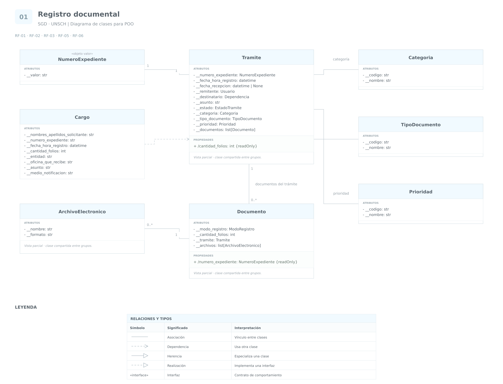

# Grupo 1 · Registro documental

**Sistema de Gestión Documental a integrar en el SIIGE**  
**Universidad Nacional de San Cristóbal de Huamanga — UNSCH**

Análisis de las funcionalidades **1, 2, 3, 5 y 6**.

Se conservan los nombres, tipos y visibilidad de las clases representadas en el
diagrama final. Los identificadores y mecanismos técnicos se presentan como
propuestas de diseño. Las clases compartidas se amplían en los demás grupos y
mantienen una sola definición en el código.

## RF-01 · Registro y número de expediente

### 1. Requerimiento original

> El Sistema de Gestión Documental (SGD) debe permitir el registro de documentos de manera manual y automatizada, GENERANDO UN NÚMERO DE EXPEDIENTE ÚNICO para cada documento y heredar a los documentos. FORMATO (DOS PRIMEROS DÍGITOS EL AÑO ACTUAL-SEIS ÚLTIMOS DÍGITOS ALEATORIOS) (Ejemplo: 2478965)

### 2. Análisis

Se modela un `Tramite` que agrupa documentos y conserva un `NumeroExpediente`.
Cada `Documento` referencia al mismo trámite; su número se consulta desde esa
relación, evitando copias que puedan quedar desactualizadas. `ModoRegistro`
distingue `MANUAL` y `AUTOMATIZADO`.

El formato escrito AA + seis dígitos implica ocho dígitos. El ejemplo de siete
dígitos se conserva en el requerimiento para señalar esa diferencia. El código
aplica la regla escrita y reserva el número con una restricción de unicidad en
SQLite. Si existe una transacción exterior, su confirmación corresponde a la
aplicación que la abrió.

### 3. Cuadro de clases y atributos

| Clase | Atributo o propiedad | Tipo de dato | Visibilidad | Justificación |
|---|---|---|---|---|
| `Tramite` | `__numero_expediente` | `NumeroExpediente` | Privado | Mantiene la información interna y permite validarla mediante operaciones. |
| `Tramite` | `__fecha_hora_registro` | `datetime` | Privado | Mantiene la información interna y permite validarla mediante operaciones. |
| `Tramite` | `__documentos` | `list[Documento]` | Privado | Mantiene la información interna y permite validarla mediante operaciones. |
| `Documento` | `__modo_registro` | `ModoRegistro` | Privado | Mantiene la información interna y permite validarla mediante operaciones. |
| `Documento` | `__tramite` | `Tramite` | Privado | Mantiene la información interna y permite validarla mediante operaciones. |
| `NumeroExpediente` | `__valor` | `str` | Privado | Mantiene la información interna y permite validarla mediante operaciones. |
| `Documento` | `numero_expediente` | `NumeroExpediente` | Propiedad pública calculada de solo lectura | Consulta el número del trámite sin guardar otra copia. |

## RF-02 · Archivos electrónicos

### 1. Requerimiento original

> El Sistema de Gestión Documental (SGD) debe permitir cargar documentos en formatos electrónicos (PDF, Word, etc.)

### 2. Análisis

`ArchivoElectronico` representa los metadatos de un adjunto. `Documento`
conserva su colección de archivos y controla su incorporación. El modo de
registro del documento y el formato de un archivo son conceptos distintos.
La ruta y la fecha de eliminación se amplían en el grupo 5.

La implementación comprueba la coherencia entre extensión y formato declarado.
La selección y carga mediante un formulario corresponde a la futura interfaz;
la clase no presupone que la extensión demuestre el contenido real del archivo.

### 3. Cuadro de clases y atributos

| Clase | Atributo o propiedad | Tipo de dato | Visibilidad | Justificación |
|---|---|---|---|---|
| `Documento` | `__archivos` | `list[ArchivoElectronico]` | Privado | Mantiene la información interna y permite validarla mediante operaciones. |
| `ArchivoElectronico` | `__nombre` | `str` | Privado | Mantiene la información interna y permite validarla mediante operaciones. |
| `ArchivoElectronico` | `__formato` | `str` | Privado | Mantiene la información interna y permite validarla mediante operaciones. |

## RF-03 · Cargo e identificación del trámite

### 1. Requerimiento original

> El sistema de Gestión documental (SGD) debe generar un cargo en trámites externos e internos, donde se indique los datos del solicitante (Nombres y apellidos), datos del expediente (número de expediente, fecha y hora del registro, cantidad de folios, entidad, oficina que recibe, asunto, medio de notificación) según formato institucional.

**Aclaración del documento:**

> (Se aclara que la generación del cargo aplica para los trámites externos, en el caso de trámites internos se refiere a la generación de un identificador único que pueda ser consultado mediante interfaz de manera amigable para conocer el estado y hoja de ruta del mismo.)

### 2. Análisis

`Cargo` conserva una instantánea de los datos exigidos para la constancia
externa. La cantidad total de folios se calcula desde los documentos del trámite.
Para trámites internos se utiliza el identificador único consultable del
expediente, de acuerdo con la aclaración.

Las copias históricas del cargo son deliberadas: una modificación posterior del
solicitante o del destino no debe cambiar una constancia ya emitida. La capa de
aplicación debe conservar el cargo emitido. `Cargo.texto()` proporciona su
contenido; la plantilla visual institucional queda pendiente de su formato.

### 3. Cuadro de clases y atributos

| Clase | Atributo o propiedad | Tipo de dato | Visibilidad | Justificación |
|---|---|---|---|---|
| `Documento` | `__cantidad_folios` | `int` | Privado | Mantiene la información interna y permite validarla mediante operaciones. |
| `Cargo` | `__nombres_apellidos_solicitante` | `str` | Privado | Conserva un dato histórico de la constancia. |
| `Cargo` | `__numero_expediente` | `str` | Privado | Conserva un dato histórico de la constancia. |
| `Cargo` | `__fecha_hora_registro` | `datetime` | Privado | Conserva un dato histórico de la constancia. |
| `Cargo` | `__cantidad_folios` | `int` | Privado | Conserva un dato histórico de la constancia. |
| `Cargo` | `__entidad` | `str` | Privado | Conserva un dato histórico de la constancia. |
| `Cargo` | `__oficina_que_recibe` | `str` | Privado | Conserva un dato histórico de la constancia. |
| `Cargo` | `__asunto` | `str` | Privado | Conserva un dato histórico de la constancia. |
| `Cargo` | `__medio_notificacion` | `str` | Privado | Conserva un dato histórico de la constancia. |
| `Tramite` | `cantidad_folios` | `int` | Propiedad pública calculada de solo lectura | Suma los folios de sus documentos. |

## RF-05 · Clasificación documental

### 1. Requerimiento original

> El Sistema de Gestión Documental (SGD) debe permitir la clasificación de los trámites según categoría, tipo de documento y prioridad.

### 2. Análisis

`Categoria`, `TipoDocumento` y `Prioridad` representan catálogos distintos.
`Tramite` mantiene referencias a sus elementos y `clasificar()` valida los tipos
antes de reemplazar la clasificación. Los códigos se distinguen de sus nombres.
Los valores concretos de los catálogos se configuran según las reglas de la universidad.

### 3. Cuadro de clases y atributos

| Clase | Atributo o propiedad | Tipo de dato | Visibilidad | Justificación |
|---|---|---|---|---|
| `Tramite` | `__categoria` | `Categoria` | Privado | Mantiene la información interna y permite validarla mediante operaciones. |
| `Tramite` | `__tipo_documento` | `TipoDocumento` | Privado | Mantiene la información interna y permite validarla mediante operaciones. |
| `Tramite` | `__prioridad` | `Prioridad` | Privado | Mantiene la información interna y permite validarla mediante operaciones. |
| `Categoria` | `__codigo` | `str` | Privado | Mantiene la información interna y permite validarla mediante operaciones. |
| `Categoria` | `__nombre` | `str` | Privado | Mantiene la información interna y permite validarla mediante operaciones. |
| `TipoDocumento` | `__codigo` | `str` | Privado | Mantiene la información interna y permite validarla mediante operaciones. |
| `TipoDocumento` | `__nombre` | `str` | Privado | Mantiene la información interna y permite validarla mediante operaciones. |
| `Prioridad` | `__codigo` | `str` | Privado | Mantiene la información interna y permite validarla mediante operaciones. |
| `Prioridad` | `__nombre` | `str` | Privado | Mantiene la información interna y permite validarla mediante operaciones. |

## RF-06 · Metadatos del trámite

### 1. Requerimiento original

> El sistema debe permitir el registro de metadatos asociados a cada trámite, tales como fecha de recepción, remitente, destinatario, asunto y estado del trámite.

### 2. Análisis

Los metadatos se conservan en `Tramite`. El remitente referencia a `Usuario`,
analizado en el grupo 2; el destinatario referencia a `Dependencia`, desarrollada
en el grupo 3. El estado cambia mediante operaciones del flujo.

La fecha de registro y la de recepción se diferencian. La recepción puede estar
pendiente y se conserva su fecha cuando el trámite retoma la atención. El asunto
se almacena una sola vez en el trámite y puede utilizarse como criterio de búsqueda.

### 3. Cuadro de clases y atributos

| Clase | Atributo o propiedad | Tipo de dato | Visibilidad | Justificación |
|---|---|---|---|---|
| `Tramite` | `__fecha_recepcion` | `datetime` o `None` | Privado | Mantiene la información interna y permite validarla mediante operaciones. |
| `Tramite` | `__remitente` | `Usuario` | Privado | Mantiene la información interna y permite validarla mediante operaciones. |
| `Tramite` | `__destinatario` | `Dependencia` | Privado | Mantiene la información interna y permite validarla mediante operaciones. |
| `Tramite` | `__asunto` | `str` | Privado | Mantiene la información interna y permite validarla mediante operaciones. |
| `Tramite` | `__estado` | `EstadoTramite` | Privado | Mantiene la información interna y permite validarla mediante operaciones. |

## Criterios del modelo de clases y del modelo de datos

El análisis considera dos perspectivas complementarias:

- Diseño orientado a objetos: responsabilidad, tipo de dato,
  visibilidad y acceso a los atributos.
- Diseño de base de datos: identificación, relaciones,
  obligatoriedad, unicidad y restricciones de los datos.

La visibilidad de un atributo no representa los permisos
de los usuarios del sistema. Estos permisos se controlan
mediante roles y autorizaciones.

### 1. Atributos privados y justificación

Se propone mantener privados los datos almacenados cuyo cambio
deba controlarse. Su consulta puede ofrecerse mediante propiedades
públicas sin permitir su modificación directa.

| Clase | Atributos privados | Justificación |
|---|---|---|
| Tramite | `__numero_expediente` | Identifica el expediente y debe conservarse después de asignarse. |
| Tramite | `__fecha_hora_registro` | Es un dato histórico del registro; no debe alterarse libremente. |
| Tramite | `__fecha_recepcion` | Debe establecerse mediante la operación de recepción. Una corrección debe estar controlada. |
| Tramite | `__remitente`, `__destinatario` | Su modificación cambia la procedencia o el destino del trámite y debe respetar el proceso. |
| Tramite | `__asunto` | Permite validar el contenido y controlar las modificaciones. |
| Tramite | `__estado` | Debe cambiar mediante operaciones permitidas del flujo, no mediante una asignación arbitraria. |
| Tramite | `__categoria`, `__tipo_documento`, `__prioridad` | Deben referenciar valores válidos de los catálogos. |
| Tramite | `__documentos` | La incorporación y desvinculación de documentos debe validar su pertenencia al trámite. |
| Documento | `__modo_registro` | Se propone conservarlo como dato histórico de cómo se registró el documento. |
| Documento | `__cantidad_folios` | Debe validarse según las reglas de foliación y el tipo de documento. |
| Documento | `__tramite` | Su modificación podría cambiar el expediente al que pertenece el documento. |
| Documento | `__archivos` | Los archivos deben incorporarse mediante una operación que valide su formato y vinculación. |
| NumeroExpediente | `__valor` | Debe conservar su formato y permanecer sin cambios después de asignarse. |
| ArchivoElectronico | `__nombre`, `__formato` | Permiten mantener coherentes los datos del archivo y controlar sus modificaciones. |
| Cargo | Todos sus atributos | Representan una constancia histórica. Se propone impedir su modificación después de la emisión. |
| Categoria | `__codigo` | Identifica el elemento del catálogo. Se propone mantenerlo estable después de utilizarse. |
| Categoria | `__nombre` | Su modificación debe validar el contenido de la denominación. |
| TipoDocumento | `__codigo` | Identifica el elemento del catálogo. Se propone mantenerlo estable después de utilizarse. |
| TipoDocumento | `__nombre` | Su modificación debe validar el contenido de la denominación. |
| Prioridad | `__codigo` | Identifica el elemento del catálogo. Se propone mantenerlo estable después de utilizarse. |
| Prioridad | `__nombre` | Su modificación debe validar el contenido de la denominación. |

Un atributo privado puede modificarse mediante un método o una
propiedad con validación cuando el proceso lo permita.
Privado no significa necesariamente inmutable.

### 2. Interfaz pública de consulta adoptada

En la versión final del diagrama y del código, `Tramite.cantidad_folios` y
`Documento.numero_expediente` son las propiedades calculadas de este grupo.
Los otros datos se consultan mediante `consultar()`, que devuelve contenedores
de lectura. Las propiedades de estado y archivo se amplían en los grupos 3 y 5.

| Clase | Acceso público implementado | Justificación |
|---|---|---|
| `Tramite` | `cantidad_folios` y `consultar()` | El total de folios se calcula; la consulta expone los metadatos y una vista de los documentos. |
| `Documento` | `numero_expediente` y `consultar()` | El número se obtiene desde el trámite; la consulta muestra modo de registro, folios y adjuntos. |
| `NumeroExpediente` | `str(numero)` y `consultar()` | Permiten obtener el valor conservando su formato. |
| `ArchivoElectronico` | `consultar()` | Permite consultar nombre y formato sin modificar sus atributos directamente. |
| `Cargo` | `texto()` y `consultar()` | Permiten presentar su información histórica. |
| `Categoria`, `TipoDocumento`, `Prioridad` | `consultar()` | Permite identificar el código y la denominación del catálogo. |

Los cambios se realizan mediante las operaciones que ofrece cada clase.
La administración adicional de los catálogos puede incorporarse cuando el
proceso institucional la precise. Este documento describe la interfaz pública
que se entrega, sin presentar un getter independiente para cada dato.

### 3. Atributos protegidos

No se proponen atributos protegidos en este grupo porque todavía
no existe una necesidad concreta de acceso directo desde subclases.

La existencia de herencia no obliga a utilizar atributos protegidos.
Las subclases pueden utilizar propiedades y métodos definidos
por la clase base.

Si posteriormente se justifica un miembro protegido,
se documentará qué subclases lo necesitan y para qué.

### 4. Consideraciones de base de datos

Las clases no se convierten automáticamente en tablas.
El modelo de almacenamiento se define según la identidad,
las relaciones y las reglas de conservación.

Las siguientes claves y restricciones son propuestas técnicas,
no campos exigidos expresamente por el requerimiento.

| Elemento | Propuesta de almacenamiento | Restricciones y justificación |
|---|---|---|
| Tramite | Tabla con id_tramite como clave primaria y numero_expediente como identificador de negocio. | numero_expediente debe ser obligatorio, único y cumplir el formato de ocho dígitos. |
| Documento | Tabla con id_documento como clave primaria e id_tramite como clave foránea. | Cada documento registrado debe vincularse a un trámite según la interpretación adoptada. |
| NumeroExpediente | Columna de Tramite; no necesita una tabla independiente inicialmente. | El objeto valor de la aplicación puede representarse mediante una sola columna. |
| ArchivoElectronico | Tabla con id_archivo como clave primaria e id_documento como clave foránea. | Permite relacionar los archivos con su documento y almacenar su información. |
| Cargo | Tabla con id_cargo como clave primaria e id_tramite como clave foránea. | Conserva los datos históricos de la constancia. La cantidad de cargos permitidos por trámite debe definirse. |
| Categoria | Tabla de catálogo con codigo como clave primaria propuesta. | Cada código identifica una categoría y su nombre debe cumplir la validación definida. |
| TipoDocumento | Tabla de catálogo con codigo como clave primaria propuesta. | Los trámites solo deben referenciar tipos existentes. |
| Prioridad | Tabla de catálogo con codigo como clave primaria propuesta. | Los trámites solo deben referenciar prioridades existentes. |

Reglas adicionales:

- Tramite referencia los catálogos mediante claves foráneas;
  no necesita repetir sus nombres como datos independientes.
- Documento referencia Tramite y no necesita almacenar otra copia
  del número de expediente.
- El número de expediente debe protegerse mediante una restricción
  de unicidad en la base de datos, incluso cuando dos registros
  se creen simultáneamente.
- La cantidad total de folios se calcula inicialmente desde los
  documentos, evitando mantener un total duplicado.
- Cargo conserva copias históricas deliberadas. Consultar siempre
  los datos actuales del usuario o de la oficina podría alterar
  la representación de una constancia ya emitida.
- fecha_recepcion puede admitir ausencia de valor mientras
  la recepción no haya ocurrido.
- Las reglas de eliminación de documentos, trámites y cargos
  se definirán con los requisitos de conservación y auditoría.
  No se presupone eliminación automática en cascada.
- Los límites de longitud de los textos deben definirse con
  los formatos institucionales, evitando asignar tamaños arbitrarios.
- Las propiedades públicas o privadas del código no sustituyen
  los permisos de acceso de la aplicación ni de la base de datos.

### 5. Convención de implementación

En Python:

- `__atributo` utiliza transformación de nombres para reducir
  accesos accidentales y conflictos con subclases.
- _atributo expresa una convención de uso interno o protegido.
- Una propiedad pública permite consultar un atributo interno
  y, cuando corresponda, modificarlo con validación.

Estas convenciones no constituyen barreras estrictas de seguridad.

## Diagrama y código del grupo

[Volver al índice](../README.md) · [Ver código](../codigo/registro_documental.py) · [Abrir draw.io editable](../diagramas/SGD_UNSCH_Diagramas_Clases.drawio)

