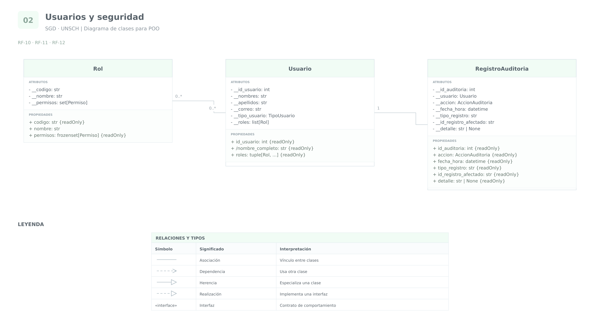

# Grupo 2 · Usuarios y seguridad

**Sistema de Gestión Documental a integrar en el SIIGE**  
**Universidad Nacional de San Cristóbal de Huamanga — UNSCH**

Análisis orientado a objetos de las funcionalidades **10, 11 y 12**.

Se identifican las clases, sus atributos y la visibilidad propuesta.
También se consideran las relaciones y restricciones necesarias
para almacenar los datos.

Los identificadores técnicos y las estructuras que no aparecen
expresamente en los requerimientos se presentan como propuestas
de diseño.

## RF-10 · Registro de usuarios externos y sus trámites

### 1. Requerimiento original

> El Sistema de Gestión documental debe permitir crear trámites para usuarios externos y registro de usuarios externos.

### 2. Análisis

El sistema debe registrar a los usuarios externos y permitir
que se creen trámites asociados a ellos.

Se identifica la clase **Usuario** y se reutiliza **Tramite**,
definida en el grupo de registro documental.

Para representar la condición de usuario externo se propone
el atributo `tipo_usuario`, utilizando una enumeración
**TipoUsuario** con los valores iniciales `INTERNO` y `EXTERNO`.

Esta clasificación no reemplaza los roles:

- El tipo de usuario identifica su relación con la institución.
- El rol establece las acciones que tiene autorizadas.

Inicialmente no se considera necesaria una subclase
UsuarioExterno, porque este requerimiento no define atributos
o comportamientos exclusivos que obliguen a utilizar herencia.

Los nombres y apellidos se relacionan con los datos del solicitante
exigidos en la funcionalidad 3. El correo se relaciona con las
comunicaciones de las funcionalidades 4 y 8.

Estos datos se incorporan en Usuario para evitar definir
nuevamente a la misma persona en cada funcionalidad.

**Relación con los trámites:**

Se propone que un usuario pueda ser remitente de varios trámites.
En este modelo, cada trámite mantiene una referencia a su remitente.

La asociación no obliga a almacenar una lista completa de trámites
dentro de Usuario. Los trámites pueden consultarse a partir
de su referencia al remitente.

**Consideraciones de base de datos:**

- Se propone `id_usuario` como clave primaria.
- Tramite debe referenciar al usuario mediante una clave foránea.
- Los nombres no deben utilizarse como identificadores únicos,
  porque diferentes personas pueden tener los mismos nombres.
- La unicidad del correo depende de cómo se definan las cuentas.
  El requerimiento no establece que cada correo corresponda
  obligatoriamente a un único usuario.
- Debe definirse cómo se verificará la identidad del usuario externo
  y cómo se evitarán registros duplicados.

### 3. Cuadro de clases y atributos

| Clase | Atributo o propiedad | Tipo de dato | Visibilidad | Justificación |
|---|---|---|---|---|
| `Usuario` | `__id_usuario` | `int` | Privado | Identificador técnico propuesto. Se consulta sin permitir su modificación directa. |
| `Usuario` | `__nombres` | `str` | Privado | Permite validar y controlar las modificaciones de los datos del usuario. |
| `Usuario` | `__apellidos` | `str` | Privado | Permite validar y controlar las modificaciones de los datos del usuario. |
| `Usuario` | `__correo` | `str` | Privado | Su modificación afecta las comunicaciones y debe validarse. |
| `Usuario` | `__tipo_usuario` | `TipoUsuario` | Privado | Evita cambiar libremente la clasificación interna o externa. |
| `Usuario` | `id_usuario` | `int` | Propiedad pública de solo lectura | Permite identificar al usuario sin modificar su identidad. |
| `Usuario` | `nombre_completo` | `str` | Propiedad pública calculada de solo lectura | Obtiene el nombre completo desde nombres y apellidos, sin guardar otra copia. |
| `Tramite` | `__remitente` | `Usuario` | Privado | Vincula el trámite con su remitente. Este atributo se reutiliza del grupo 1. |

Los nombres, apellidos y correo pueden consultarse mediante
propiedades públicas. Las modificaciones se realizarán mediante
operaciones que validen los datos y la autorización del solicitante.

No se proponen atributos protegidos porque todavía no se ha
justificado una jerarquía de usuarios que necesite acceso directo
a datos internos.

## RF-11 · Control de acceso basado en roles

### 1. Requerimiento original

> El Sistema de Gestión Documental (SGD) debe implementar controles de acceso basados en roles, permitiendo que solo los usuarios autorizados puedan visualizar, modificar o aprobar documentos.

### 2. Análisis

El requerimiento establece que las operaciones sobre los documentos
deben autorizarse según los roles del usuario.

Se identifica la clase **Rol**, se reutiliza **Usuario**
y se propone la enumeración **Permiso**.

Las acciones expresamente mencionadas son:

- `VISUALIZAR`
- `MODIFICAR`
- `APROBAR`

**Responsabilidad de cada elemento:**

- **Usuario:** mantiene los roles que tiene asignados.
- **Rol:** agrupa los permisos autorizados.
- **Permiso:** representa una acción que puede autorizarse.

Se propone que un usuario pueda tener varios roles y que un rol
pueda asignarse a varios usuarios.

El requerimiento no fija cuántos roles puede tener cada usuario;
la asignación múltiple es una decisión de diseño que permite
representar responsabilidades combinadas.

Los perfiles como administrativo, gestor o directivo pueden
representarse mediante roles configurables. No es necesario
convertir cada perfil en una subclase de Usuario.

Antes de ejecutar una operación, el sistema debe comprobar
si el usuario tiene el permiso correspondiente.

La comprobación debe realizarse en la lógica que procesa
la operación. Ocultar un botón en la interfaz no constituye
por sí solo un control de acceso suficiente.

Además, deben precisarse las restricciones sobre los documentos:
tener un permiso no implica necesariamente poder utilizarlo
sobre cualquier documento de cualquier dependencia.

**Consideraciones de base de datos:**

- Se propone `codigo` como clave primaria de Rol.
- La relación entre usuarios y roles requiere una tabla
  intermedia, por ejemplo `usuario_rol`.
- Esa tabla relaciona `id_usuario` con `codigo_rol`.
- La combinación de ambos campos debe ser única para evitar
  asignaciones duplicadas.
- La relación entre roles y permisos puede almacenarse
  en una tabla `rol_permiso`.
- La combinación de rol y permiso también debe ser única.
- Los valores de permiso deben limitarse a las acciones admitidas.
- Las asignaciones de roles y permisos deben estar sujetas
  a autorización y auditoría.

### 3. Cuadro de clases y atributos

| Clase | Atributo o propiedad | Tipo de dato | Visibilidad | Justificación |
|---|---|---|---|---|
| `Usuario` | `__roles` | `list[Rol]` | Privado | Evita asignar o retirar roles modificando directamente la colección interna. |
| `Rol` | `__codigo` | `str` | Privado | Identifica al rol y se propone mantenerlo estable mientras esté referenciado. |
| `Rol` | `__nombre` | `str` | Privado | Permite validar las modificaciones de su denominación. |
| `Rol` | `__permisos` | `set[Permiso]` | Privado | Controla la incorporación y retirada de permisos; el conjunto evita repeticiones en memoria. |
| `Usuario` | `roles` | `tuple[Rol, ...]` | Propiedad pública de solo lectura | Permite consultar los roles sin agregar o retirar elementos directamente de la colección interna. |
| `Rol` | `codigo` | `str` | Propiedad pública de solo lectura | Permite identificar el rol sin modificar su código. |
| `Rol` | `nombre` | `str` | Propiedad pública de lectura y escritura validada | Permite mostrar su denominación; los cambios se realizan mediante una operación validada. |
| `Rol` | `permisos` | `frozenset[Permiso]` | Propiedad pública de solo lectura | Permite consultar los permisos sin modificar directamente el conjunto interno. |

Permiso es una enumeración. Sus valores representan acciones;
no son atributos privados de una persona.

Que `__roles` y `__permisos` sean privados protege el uso de las
clases frente a modificaciones directas accidentales.
La seguridad requiere, además, comprobar quién está autorizado
para realizar las operaciones de asignación.

No se proponen atributos protegidos: los roles y permisos
se administran mediante operaciones controladas, sin necesitar
acceso directo desde subclases.

## RF-12 · Registro de auditoría

### 1. Requerimiento original

> El Sistema de Gestión Documental (SGD) debe registrar un log de auditoría que muestre quién accede, modifica o elimina documentos en el sistema.

**Aclaración del documento:**

> (El sistema debe contemplar para el log de auditoría la persistencia de datos de creación, modificación y eliminación de registros del sistema, para ello, debe almacenarse en base de datos dicha información.)

### 2. Análisis

El sistema debe conservar información que permita conocer
quién realizó una acción y qué registro resultó afectado.

El texto principal menciona acceso, modificación y eliminación
de documentos. La aclaración incorpora la creación y amplía
el alcance a los registros del sistema.

Se identifica la clase **RegistroAuditoria** y se reutiliza
**Usuario** para representar al responsable de la acción.

También se propone la enumeración **AccionAuditoria**
con los valores:

- `ACCESO`
- `CREACION`
- `MODIFICACION`
- `ELIMINACION`

Cada RegistroAuditoria representa un evento ocurrido.

Para que el evento sea interpretable se proponen:

- Identificación del evento.
- Usuario responsable.
- Acción realizada.
- Fecha y hora.
- Tipo de registro afectado.
- Identificador del registro afectado.
- Un detalle complementario cuando sea necesario.

La fecha y los datos del registro afectado no se enumeran
expresamente en el requerimiento. Se proponen porque permiten
ubicar y comprender la acción registrada.

La auditoría no debe limitarse a una lista temporal en memoria:
la aclaración exige almacenamiento en base de datos.

Se propone que los eventos confirmados no puedan editarse
desde las operaciones normales de la aplicación. Una rectificación
debe registrarse como un nuevo evento que explique la situación,
conservando el historial original.

Los procesos automáticos también deben poder atribuirse a un actor
identificable. Debe definirse cómo se representarán esos actores,
por ejemplo mediante cuentas de servicio.

**Consideraciones de base de datos:**

- Se propone `id_auditoria` como clave primaria.
- El usuario responsable se referencia mediante su identificador.
- Debe conservarse la trazabilidad aunque el registro afectado
  haya sido eliminado.
- No debe configurarse una eliminación en cascada que borre
  automáticamente la auditoría al eliminar el registro original.
- El identificador del registro afectado puede corresponder
  a distintas entidades. No constituye una única clave foránea
  convencional hacia todas sus tablas.
- Deben definirse permisos de consulta y conservación
  de la información de auditoría.
- El detalle debe limitarse a la información necesaria para
  explicar el evento, evitando copiar datos completos sin necesidad.

### 3. Cuadro de clases y atributos

| Clase | Atributo o propiedad | Tipo de dato | Visibilidad | Justificación |
|---|---|---|---|---|
| `RegistroAuditoria` | `__id_auditoria` | `int` | Privado | Identificador técnico propuesto para distinguir cada evento. |
| `RegistroAuditoria` | `__usuario` | `Usuario` | Privado | Conserva la referencia al responsable; no debe sustituirse después de confirmar el evento. |
| `RegistroAuditoria` | `__accion` | `AccionAuditoria` | Privado | Conserva la acción registrada sin permitir su alteración posterior. |
| `RegistroAuditoria` | `__fecha_hora` | `datetime` | Privado | Permite ubicar temporalmente el evento y preservar su orden histórico. |
| `RegistroAuditoria` | `__tipo_registro` | `str` | Privado | Identifica la entidad afectada, por ejemplo Documento o Tramite. |
| `RegistroAuditoria` | `__id_registro_afectado` | `str` | Privado | Conserva la identificación del registro sobre el que se realizó la acción. |
| `RegistroAuditoria` | `__detalle` | `str` o `None` | Privado | Conserva una explicación complementaria del evento cuando corresponda. |
| `RegistroAuditoria` | `id_auditoria` | `int` | Propiedad pública de solo lectura | Permite identificar el evento sin modificarlo. |
| `RegistroAuditoria` | `accion` | `AccionAuditoria` | Propiedad pública de solo lectura | Permite consultar qué acción se registró. |
| `RegistroAuditoria` | `fecha_hora` | `datetime` | Propiedad pública de solo lectura | Permite consultar cuándo ocurrió. |
| `RegistroAuditoria` | `tipo_registro` | `str` | Propiedad pública de solo lectura | Permite identificar qué entidad resultó afectada. |
| `RegistroAuditoria` | `id_registro_afectado` | `str` | Propiedad pública de solo lectura | Permite localizar o identificar el registro afectado. |
| `RegistroAuditoria` | `detalle` | `str` o `None` | Propiedad pública de solo lectura | Permite consultar la explicación sin modificar el evento. |

La consulta del responsable puede exponerse mediante una propiedad
pública de lectura. Esto no debe permitir modificar al usuario
a través del registro de auditoría.

No se proponen atributos protegidos porque un evento de auditoría
no necesita que las subclases modifiquen directamente sus datos.

Que una propiedad sea pública significa que forma parte de la
interfaz de consulta de la clase. No significa que todos los usuarios
del sistema estén autorizados a consultar los registros de auditoría.

## Diagrama y código del grupo

[Volver al índice](../README.md) · [Ver código](../codigo/usuarios_y_seguridad.py) · [Abrir draw.io editable](../diagramas/SGD_UNSCH_Diagramas_Clases.drawio)

