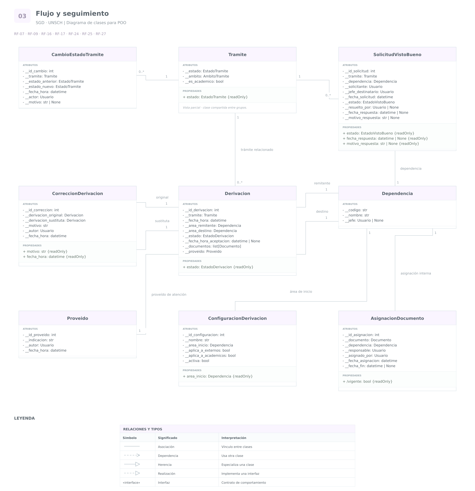

# Grupo 3 · Flujo y seguimiento

**Sistema de Gestión Documental a integrar en el SIIGE**  
**Universidad Nacional de San Cristóbal de Huamanga — UNSCH**

Análisis de las funcionalidades **7, 9, 16, 17, 24, 25 y 27**.

Las clases compartidas se reutilizan. Los atributos presentados
amplían su definición; no representan nuevas versiones de la misma clase.

La visibilidad corresponde al diseño orientado a objetos.
Las claves y restricciones de almacenamiento se analizan por separado.

## RF-07 · Seguimiento del estado de los trámites

### 1. Requerimiento original

> El Sistema de Gestión Documental (SGD) debe permitir el seguimiento en tiempo real del estado de los trámites a lo largo del proceso de trámite.

### 2. Análisis

Se reutiliza **Tramite**, cuyo atributo `estado` permite conocer
su situación actual.

También se propone **CambioEstadoTramite** para conservar
los cambios de estado como eventos históricos.

Esta clase permite registrar qué cambió, cuándo ocurrió
y quién realizó la operación. Su incorporación es una decisión
de diseño para facilitar el seguimiento y explicar el estado actual.

El estado del trámite debe diferenciarse del estado
de cada derivación. Un trámite puede tener varias derivaciones
y sus destinatarios pueden atenderlas en momentos distintos.

**EstadoTramite** representará los estados admitidos.
Como propuesta inicial pueden considerarse:

- `REGISTRADO`
- `EN_ATENCION`
- `OBSERVADO`
- `PENDIENTE_VISTO_BUENO`
- `FINALIZADO`

Estos valores y sus transiciones deben validarse con el proceso
institucional; no están enumerados expresamente en RF-07.

“Tiempo real” describe el comportamiento esperado de actualización.
No se representa mediante un atributo llamado `tiempo_real`.

Debe definirse el tiempo máximo aceptable entre un cambio confirmado
y su visualización por los usuarios autorizados.

**Consideraciones de base de datos:**

- Tramite conserva el estado actual.
- Cada cambio se almacena como un registro histórico.
- El cambio del estado actual y su registro histórico deben
  confirmarse de manera consistente.
- El historial no debe reemplazarse al registrar un nuevo cambio.

### 3. Cuadro de clases y atributos

| Clase | Atributo o propiedad | Tipo de dato | Visibilidad | Justificación |
|---|---|---|---|---|
| `Tramite` | `__estado` | `EstadoTramite` | Privado | Permite cambiar de estado únicamente mediante operaciones válidas. Se reutiliza del grupo 1. |
| `Tramite` | `estado` | `EstadoTramite` | Propiedad pública de solo lectura | Permite consultar la situación actual sin modificarla directamente. |
| `CambioEstadoTramite` | `__id_cambio` | `int` | Privado | Identificador técnico propuesto para cada evento. |
| `CambioEstadoTramite` | `__tramite` | `Tramite` | Privado | Identifica el trámite cuyo estado cambió. |
| `CambioEstadoTramite` | `__estado_anterior` | `EstadoTramite` | Privado | Conserva la situación previa. |
| `CambioEstadoTramite` | `__estado_nuevo` | `EstadoTramite` | Privado | Conserva la situación resultante. |
| `CambioEstadoTramite` | `__fecha_hora` | `datetime` | Privado | Conserva cuándo ocurrió el cambio. |
| `CambioEstadoTramite` | `__actor` | `Usuario` | Privado | Identifica al responsable de la operación. |
| `CambioEstadoTramite` | `__motivo` | `str` o `None` | Privado | Permite explicar el cambio cuando corresponda. |

Los eventos confirmados se proponen de solo lectura.
Sus datos pueden consultarse mediante propiedades públicas.

El historial funcional explica el recorrido del trámite.
El registro de auditoría del grupo 2 permite rastrear las acciones
realizadas en el sistema; ambos tienen finalidades relacionadas,
pero diferentes.

## RF-09 · Historial de derivaciones

### 1. Requerimiento original

> El Sistema de Gestión Documental (SGD) debe permitir visualizar un historial de todas las derivaciones realizadas sobre el trámite, incluyendo fechas, área destino, área remitente.

### 2. Análisis

Se identifica **Derivacion** como el registro de un envío
entre dependencias.

Cada derivación debe conservar la fecha y las referencias
a las áreas remitente y destinataria.

También se utiliza **Dependencia** para representar las áreas,
oficinas o dependencias participantes. Se propone una clase
compartida para estos términos, pendiente de validar
que correspondan a la misma estructura organizacional.

El historial está formado por las derivaciones relacionadas
con el trámite; no necesita una clase adicional que solamente
duplique esos registros.

Se propone **EstadoDerivacion** con los valores:

- `PENDIENTE`
- `ACEPTADA`
- `CORREGIDA`

Estos estados permiten atender la condición establecida
en la funcionalidad 27.

**Consideraciones de base de datos:**

- Cada derivación tiene un identificador propio.
- Se relaciona con un trámite y con dos dependencias.
- Las dependencias se referencian mediante claves foráneas.
- Registrar una nueva derivación no debe sobrescribir la anterior.
- La consulta debe ofrecer un orden cronológico estable,
  utilizando fecha y un identificador de desempate.
- Si se requiere conservar nombres históricos de las áreas,
  debe definirse el mecanismo de versionado o de copia histórica.

### 3. Cuadro de clases y atributos

| Clase | Atributo o propiedad | Tipo de dato | Visibilidad | Justificación |
|---|---|---|---|---|
| `Derivacion` | `__id_derivacion` | `int` | Privado | Identificador técnico propuesto para distinguir cada envío. |
| `Derivacion` | `__tramite` | `Tramite` | Privado | Conserva la referencia al trámite relacionado. |
| `Derivacion` | `__fecha_hora` | `datetime` | Privado | Conserva cuándo se realizó el envío. |
| `Derivacion` | `__area_remitente` | `Dependencia` | Privado | Conserva la dependencia que realizó la derivación. |
| `Derivacion` | `__area_destino` | `Dependencia` | Privado | Conserva la dependencia a la que se dirigió el envío. |
| `Derivacion` | `__estado` | `EstadoDerivacion` | Privado | Controla la aceptación o corrección mediante operaciones válidas. |
| `Derivacion` | `__fecha_hora_aceptacion` | `datetime` o `None` | Privado | Registra cuándo fue aceptada; permanece vacía mientras no ocurra. |
| `Derivacion` | `estado` | `EstadoDerivacion` | Propiedad pública de solo lectura | Permite consultar la situación del envío. |
| `Dependencia` | `__codigo` | `str` | Privado | Identificador propuesto para referenciar cada dependencia. |
| `Dependencia` | `__nombre` | `str` | Privado | Permite administrar su denominación mediante modificaciones validadas. |

Las fechas y áreas de una derivación confirmada se proponen
de solo lectura. Una corrección debe conservar lo sucedido,
según se desarrolla en RF-27.

## RF-16 · Solicitud de visto bueno

### 1. Requerimiento original

> El Sistema de Gestión Documental (SGD) debe permitir elevar el trámite al jefe de la dependencia como solicitud de visto bueno a nivel de estado para poder dar continuidad al trámite.

### 2. Análisis

Se identifica **SolicitudVistoBueno** como un registro diferente
del trámite.

Esta separación permite conservar cada solicitud, su responsable
y su resultado, sin limitarse a sobrescribir un estado
dentro de Tramite.

Se reutilizan **Tramite**, **Usuario** y **Dependencia**.

El jefe es un usuario que tiene una responsabilidad organizacional.
No se propone una clase Jefe únicamente por desempeñar ese cargo.

Se propone **EstadoVistoBueno**, cuyos valores iniciales son:

- `PENDIENTE`
- `APROBADO`
- `OBSERVADO`

Estos estados son una propuesta: el documento solo menciona
la solicitud y el cambio de estado.

La solicitud y el trámite tienen estados distintos:

- EstadoVistoBueno indica la situación de la solicitud.
- EstadoTramite indica la situación general del trámite.

Cuando la continuidad dependa del visto bueno, el flujo debe impedir
el avance hasta que se cumpla la condición de aprobación.

**Consideraciones de base de datos:**

- La solicitud tiene una clave primaria propia.
- Referencia al trámite, a la dependencia y a los usuarios
  solicitante y responsable.
- Se conserva cada solicitud, incluso si después se presenta otra.
- Debe definirse si se permite más de una solicitud pendiente
  para el mismo trámite y dependencia.
- La autorización debe considerar al jefe de la dependencia
  correspondiente, no solamente un rol genérico de directivo.

### 3. Cuadro de clases y atributos

| Clase | Atributo o propiedad | Tipo de dato | Visibilidad | Justificación |
|---|---|---|---|---|
| `SolicitudVistoBueno` | `__id_solicitud` | `int` | Privado | Identificador técnico propuesto. |
| `SolicitudVistoBueno` | `__tramite` | `Tramite` | Privado | Identifica el trámite que requiere el visto bueno. |
| `SolicitudVistoBueno` | `__dependencia` | `Dependencia` | Privado | Identifica la dependencia en la que se solicita. |
| `SolicitudVistoBueno` | `__solicitante` | `Usuario` | Privado | Conserva quién elevó la solicitud. |
| `SolicitudVistoBueno` | `__jefe_destinatario` | `Usuario` | Privado | Conserva a quién se dirigió la solicitud. |
| `SolicitudVistoBueno` | `__fecha_solicitud` | `datetime` | Privado | Conserva cuándo se presentó. |
| `SolicitudVistoBueno` | `__estado` | `EstadoVistoBueno` | Privado | Evita aprobar u observar mediante una asignación directa. |
| `SolicitudVistoBueno` | `estado` | `EstadoVistoBueno` | Propiedad pública de solo lectura | Permite consultar la situación de la solicitud. |
| `Dependencia` | `__jefe` | `Usuario` o `None` | Privado | Referencia propuesta al jefe designado; su modificación debe estar autorizada. |

Antes de solicitar o resolver el visto bueno debe comprobarse
la designación correspondiente. Los cambios de jefatura o las
delegaciones requieren una regla institucional específica.

## RF-17 · Notificación y resolución del visto bueno

### 1. Requerimiento original

> El Sistema de Gestión Documental (SGD) debe permitir notificaciones para informar sobre la solicitud de un visto bueno y permitir al jefe poder cambiar el estado del mismo.

### 2. Análisis

Se reutiliza **SolicitudVistoBueno** y se amplía con los datos
de su resolución.

Las notificaciones se gestionarán mediante las clases del grupo 4.
No es necesario almacenar un objeto notificador como atributo
permanente de la solicitud para representar este requerimiento.

Se distinguen dos acciones:

- Informar al responsable de que existe una solicitud.
- Permitir que el jefe autorizado cambie su estado.

Recibir una notificación no concede permiso para resolver
la solicitud.

Como propuesta, una resolución conserva quién respondió,
cuándo lo hizo y el motivo o comentario correspondiente.

Si se utiliza el estado OBSERVADO, se propone exigir
una explicación que permita atender la observación.

**Consideraciones de base de datos:**

- Se actualiza la solicitud existente al resolverla.
- La respuesta debe relacionarse con el usuario que efectivamente
  la realizó.
- El cambio debe registrarse en auditoría.
- Deben impedirse resoluciones incompatibles realizadas
  simultáneamente sobre una misma solicitud.
- Un fallo de correo no debe eliminar una solicitud válida;
  el envío y sus reintentos se controlarán en el grupo 4.

### 3. Cuadro de clases y atributos

| Clase | Atributo o propiedad | Tipo de dato | Visibilidad | Justificación |
|---|---|---|---|---|
| `SolicitudVistoBueno` | `__estado` | `EstadoVistoBueno` | Privado | Cambia mediante una operación que valida la autorización y la transición. |
| `SolicitudVistoBueno` | `__resuelto_por` | `Usuario` o `None` | Privado | Conserva quién realizó efectivamente la resolución. |
| `SolicitudVistoBueno` | `__fecha_respuesta` | `datetime` o `None` | Privado | Conserva cuándo se resolvió. |
| `SolicitudVistoBueno` | `__motivo_respuesta` | `str` o `None` | Privado | Conserva la explicación de la resolución. |
| `SolicitudVistoBueno` | `fecha_respuesta` | `datetime` o `None` | Propiedad pública de solo lectura | Permite consultar cuándo se resolvió. |
| `SolicitudVistoBueno` | `motivo_respuesta` | `str` o `None` | Propiedad pública de solo lectura | Permite consultar la explicación sin modificarla directamente. |

Los campos de resolución son propuestas de diseño para conservar
la trazabilidad de la decisión.

## RF-24 · Asignación masiva dentro de una dependencia

### 1. Requerimiento original

> El Sistema de Gestión Documental (SGD) debe permitir la asignación masiva de documentos dentro de una dependencia administrativa.

### 2. Análisis

Se propone **AsignacionDocumento** para representar
la responsabilidad de atención sobre un documento.

Se reutilizan **Documento**, **Usuario** y **Dependencia**.

El requerimiento menciona documentos, por lo que no se asume
que asignar un documento significa asignar automáticamente
todos los documentos del trámite.

La asignación se diferencia de la derivación:

- Asignación: establece quién atenderá el documento
  dentro de una dependencia.
- Derivación: registra su envío entre dependencias.

Como propuesta, el responsable es un usuario que pertenece
a la dependencia correspondiente.

La pertenencia organizacional debe comprobarse mediante
la relación vigente entre usuarios y dependencias.

“Masiva” describe una operación que procesa varios documentos.
No exige una clase independiente por cada tamaño de lote.

**Consideraciones de base de datos:**

- Cada asignación conserva el documento, el responsable,
  la dependencia y quién la realizó.
- Una reasignación debe preservar la asignación anterior
  si se requiere conocer el historial de responsables.
- Se propone una fecha de finalización para distinguir
  asignaciones vigentes de anteriores.
- Debe definirse si un documento admite uno o varios responsables
  simultáneos.
- La operación masiva debe informar qué asignaciones se realizaron
  y cuáles no pudieron completarse.
- Debe definirse si el lote se confirma completo o permite
  resultados parciales.

### 3. Cuadro de clases y atributos

| Clase | Atributo o propiedad | Tipo de dato | Visibilidad | Justificación |
|---|---|---|---|---|
| `AsignacionDocumento` | `__id_asignacion` | `int` | Privado | Identificador técnico propuesto para cada asignación. |
| `AsignacionDocumento` | `__documento` | `Documento` | Privado | Identifica el documento asignado. |
| `AsignacionDocumento` | `__dependencia` | `Dependencia` | Privado | Conserva el contexto organizacional de la asignación. |
| `AsignacionDocumento` | `__responsable` | `Usuario` | Privado | Identifica al usuario encargado de atenderlo. |
| `AsignacionDocumento` | `__asignado_por` | `Usuario` | Privado | Conserva quién realizó la asignación. |
| `AsignacionDocumento` | `__fecha_asignacion` | `datetime` | Privado | Conserva cuándo se realizó. |
| `AsignacionDocumento` | `__fecha_fin` | `datetime` o `None` | Privado | Permite finalizar la asignación conservando su historial. |
| `AsignacionDocumento` | `vigente` | `bool` | Propiedad pública calculada de solo lectura | Se obtiene comprobando si la asignación tiene fecha de finalización. |

Las referencias y fechas se modifican mediante operaciones
controladas; no mediante escritura directa sobre sus atributos.

## RF-25 · Derivación masiva y configuración del área de inicio

### 1. Requerimiento original

> El sistema de Gestión Documental (SGD) debe permitir la derivación masiva de documentos entre dependencias, mediante un proveído de atención (Trámites académicos, internos, externos).

**Aclaración del documento:**

> (Se aclara que el objetivo del proyecto busca descentralizar y optimizar el flujo de trámite documentario. Por lo cual, el sistema debe permitir configurar para trámites externos y académicos el área de inicio para permitir la derivación automática a los trámites que se configuren en el sistema.)

### 2. Análisis

El requerimiento contiene dos capacidades:

- Derivar documentos de forma masiva entre dependencias,
  acompañados por un proveído de atención.
- Configurar el área de inicio para la derivación automática
  de determinados trámites externos y académicos.

Se reutilizan **Derivacion**, **Documento**, **Tramite**,
**Usuario** y **Dependencia**.

Se incorporan:

- **Proveido:** representa la indicación de atención.
- **ConfiguracionDerivacion:** representa las reglas iniciales
  necesarias para seleccionar la dependencia de inicio.

La derivación debe identificar los documentos incluidos.
No se asume que siempre se envían todos los documentos del trámite.

Un lote puede contener documentos de distintos trámites.
Cada derivación debe mantener su relación con el trámite
y con los documentos que correspondan.

También debe aclararse si un único proveído puede acompañar
varias derivaciones del mismo lote.

**Clasificación del trámite:**

“Académico” y “externo” no se consideran necesariamente
categorías excluyentes. Un trámite académico podría
haber sido presentado por un usuario externo.

Se propone distinguir:

- Ámbito: interno o externo.
- Condición académica: indica si corresponde a un proceso académico.

Esta separación es una propuesta de modelado que evita
forzar tres subclases mutuamente excluyentes.

**Consideraciones de base de datos:**

- Proveido tiene identificación propia y referencia a su autor.
- Derivacion referencia el proveído que la acompaña.
- La asociación entre derivaciones y documentos puede representarse
  mediante una tabla intermedia.
- Debe comprobarse que los documentos incluidos correspondan
  al trámite de la derivación.
- La configuración referencia una dependencia existente.
- La derivación automática debe evitar crear envíos duplicados
  cuando se repita el procesamiento de un mismo registro.
- Si existen varias configuraciones aplicables, debe definirse
  cómo se selecciona una sin ambigüedad.

### 3. Cuadro de clases y atributos

| Clase | Atributo o propiedad | Tipo de dato | Visibilidad | Justificación |
|---|---|---|---|---|
| `Derivacion` | `__documentos` | `list[Documento]` | Privado | Controla qué documentos se incluyen en el envío. |
| `Derivacion` | `__proveido` | `Proveido` | Privado | Vincula el envío con su indicación de atención. |
| `Proveido` | `__id_proveido` | `int` | Privado | Identificador técnico propuesto. |
| `Proveido` | `__indicacion` | `str` | Privado | Conserva la instrucción de atención y permite validar su contenido. |
| `Proveido` | `__autor` | `Usuario` | Privado | Conserva quién emitió la indicación. |
| `Proveido` | `__fecha_hora` | `datetime` | Privado | Conserva cuándo se emitió. |
| `Tramite` | `__ambito` | `AmbitoTramite` | Privado | Clasificación propuesta para distinguir trámites internos y externos. |
| `Tramite` | `__es_academico` | `bool` | Privado | Permite representar la condición académica sin hacerla excluyente del ámbito. |
| `ConfiguracionDerivacion` | `__id_configuracion` | `int` | Privado | Identificador técnico propuesto. |
| `ConfiguracionDerivacion` | `__nombre` | `str` | Privado | Identifica la configuración para su administración. |
| `ConfiguracionDerivacion` | `__area_inicio` | `Dependencia` | Privado | Define la dependencia a la que se dirige inicialmente el trámite configurado. |
| `ConfiguracionDerivacion` | `__aplica_a_externos` | `bool` | Privado | Indica si la configuración considera trámites externos. |
| `ConfiguracionDerivacion` | `__aplica_a_academicos` | `bool` | Privado | Indica si considera trámites académicos. |
| `ConfiguracionDerivacion` | `__activa` | `bool` | Privado | Permite habilitar o deshabilitar la configuración sin eliminarla. |
| `ConfiguracionDerivacion` | `area_inicio` | `Dependencia` | Propiedad pública de solo lectura | Permite consultar el destino configurado sin cambiarlo directamente. |

Los indicadores de aplicación no definen por sí solos una regla
completa. Debe precisarse si una configuración se aplica a cualquiera
de las condiciones marcadas o exige su combinación.

Los atributos de configuración son modificables mediante
operaciones autorizadas y auditadas.

El proveído emitido se propone de solo lectura.
Una rectificación debe conservar la trazabilidad correspondiente.

## RF-27 · Corrección de una derivación errada

### 1. Requerimiento original

> El Sistema de Gestión Documental (SGD) debe permitir la corrección de una derivación errada en el caso el trámite no fuera aceptado aún por la otra dependencia; la corrección de la derivación tiene que almacenar el motivo porque se está haciendo la corrección.

### 2. Análisis

La corrección está condicionada a que la derivación
todavía no haya sido aceptada por la dependencia destinataria.

Se reutiliza **Derivacion** y se propone **CorreccionDerivacion**
para conservar el motivo y los datos de la rectificación.

Como diseño se propone:

1. Conservar la derivación original.
2. Registrar el motivo y al responsable de la corrección.
3. Marcar la derivación original como CORREGIDA.
4. Crear una derivación sustitutoria con los datos corregidos
   y estado PENDIENTE.

Este mecanismo evita modificar silenciosamente el historial.

La derivación sustitutoria no representa necesariamente
otro paso del recorrido: reemplaza un envío pendiente
que se registró de forma incorrecta.

La restricción debe comprobarse sobre la derivación concreta,
especialmente cuando un trámite tiene varios envíos pendientes.

**Reglas de la corrección:**

- La derivación debe encontrarse pendiente de aceptación.
- El motivo debe estar registrado y no puede estar vacío.
- Debe comprobarse la autorización del usuario.
- Una derivación aceptada no puede corregirse mediante
  esta operación.
- Si corresponde devolver o redirigir un envío ya aceptado,
  debe definirse otro procedimiento institucional.

**Consideraciones de base de datos:**

- La corrección tiene identificación propia.
- Referencia a la derivación original y a la sustitutoria.
- La actualización del estado, la nueva derivación y el registro
  de la corrección deben confirmarse como una sola operación.
- Debe impedirse que una aceptación y una corrección simultáneas
  se confirmen sobre la misma derivación pendiente.
- No basta con consultar el estado y actualizarlo después
  sin controlar la concurrencia.
- Se propone permitir una sola sustitución directa por cada
  derivación original.
- La corrección debe registrarse también en auditoría.

### 3. Cuadro de clases y atributos

| Clase | Atributo o propiedad | Tipo de dato | Visibilidad | Justificación |
|---|---|---|---|---|
| `Derivacion` | `__estado` | `EstadoDerivacion` | Privado | Permite validar que siga pendiente antes de corregirla. |
| `CorreccionDerivacion` | `__id_correccion` | `int` | Privado | Identificador técnico propuesto para la rectificación. |
| `CorreccionDerivacion` | `__derivacion_original` | `Derivacion` | Privado | Conserva la referencia al envío registrado erróneamente. |
| `CorreccionDerivacion` | `__derivacion_sustituta` | `Derivacion` | Privado | Identifica el envío que reemplaza al original. |
| `CorreccionDerivacion` | `__motivo` | `str` | Privado | Conserva la explicación obligatoria de la corrección. |
| `CorreccionDerivacion` | `__autor` | `Usuario` | Privado | Conserva quién realizó la rectificación. |
| `CorreccionDerivacion` | `__fecha_hora` | `datetime` | Privado | Conserva cuándo se realizó. |
| `CorreccionDerivacion` | `motivo` | `str` | Propiedad pública de solo lectura | Permite consultar la explicación sin modificarla después de confirmar la corrección. |
| `CorreccionDerivacion` | `fecha_hora` | `datetime` | Propiedad pública de solo lectura | Permite consultar cuándo se realizó. |

Los datos de la corrección confirmada se proponen inmutables.

En este grupo no se identifican atributos que necesiten
acceso protegido desde subclases. La colaboración entre clases
se realiza mediante propiedades y operaciones públicas controladas.

## Diagrama y código del grupo

[Volver al índice](../README.md) · [Ver código](../codigo/flujo_y_seguimiento.py) · [Abrir draw.io editable](../diagramas/SGD_UNSCH_Diagramas_Clases.drawio)

