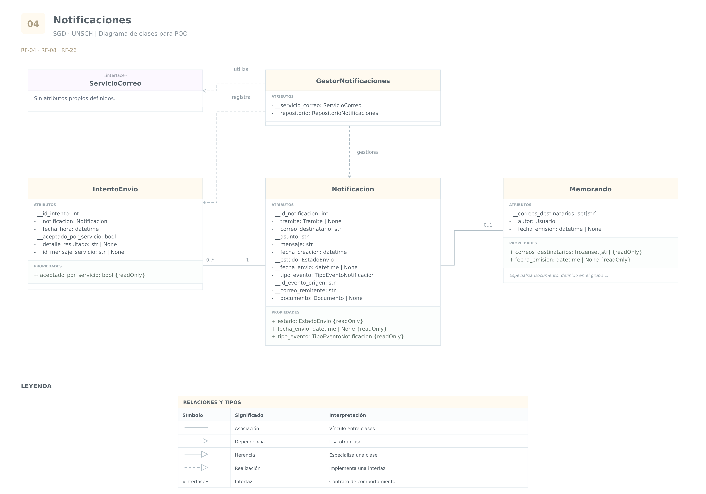

# Grupo 4 · Notificaciones

**Sistema de Gestión Documental a integrar en el SIIGE**  
**Universidad Nacional de San Cristóbal de Huamanga — UNSCH**

Análisis de las funcionalidades **4, 8 y 26**.

Este grupo también proporciona las notificaciones utilizadas
por la solicitud de visto bueno de la funcionalidad 17,
analizada en el grupo de flujo y seguimiento.

Las clases compartidas se reutilizan. Los atributos y mecanismos
que no están expresamente definidos en los requerimientos
se presentan como propuestas de diseño.

## RF-04 · Comunicación por correo de la recepción

### 1. Requerimiento original

> El sistema de Gestión Documental (SGD) debe de comunicar al correo sobre la recepción del trámite.

### 2. Análisis

El sistema debe comunicar por correo electrónico que un trámite
ha sido recibido.

Se identifica la clase **Notificacion** para representar
el mensaje dirigido a un destinatario.

Se reutilizan:

- **Tramite:** identifica el trámite relacionado.
- **Usuario:** proporciona el correo del destinatario,
  cuando este corresponde a un usuario registrado.

Se propone que cada Notificacion represente un envío
a una sola dirección de correo.

Si un mismo evento debe comunicarse a varios destinatarios,
se crean notificaciones relacionadas con ese evento.
Esto permite controlar el resultado del envío a cada destinatario.

La recepción del trámite y el envío del correo son hechos distintos.
Un trámite puede haberse recibido correctamente aunque
el servicio de correo falle.

Por ello, la aplicación debe conservar la notificación pendiente
y permitir su procesamiento posterior.

Se propone la enumeración **EstadoEnvio**:

- `PENDIENTE`
- `ENVIADO`
- `FALLIDO`

En este modelo, ENVIADO significa que el servicio de correo
aceptó el envío. No demuestra que el destinatario lo recibió
en su bandeja ni que lo leyó.

También debe precisarse qué evento institucional constituye
la recepción que origina el aviso. No se presupone que registrar,
derivar y recepcionar sean siempre la misma operación.

**Consideraciones de base de datos:**

- Se propone `id_notificacion` como clave primaria.
- La notificación referencia al trámite relacionado.
- Se conserva el correo utilizado para mantener la trazabilidad,
  aunque el usuario cambie posteriormente su dirección.
- La fecha de envío permanece vacía mientras el servicio
  no haya aceptado el mensaje.
- Un fallo de correo no debe eliminar ni invalidar
  la recepción del trámite.
- Debe definirse el contenido institucional del mensaje.

### 3. Cuadro de clases y atributos

| Clase | Atributo o propiedad | Tipo de dato | Visibilidad | Justificación |
|---|---|---|---|---|
| `Notificacion` | `__id_notificacion` | `int` | Privado | Identificador técnico propuesto para distinguir cada notificación. |
| `Notificacion` | `__tramite` | `Tramite` o `None` | Privado | Referencia al trámite relacionado; puede no aplicar a otros tipos de comunicación. |
| `Notificacion` | `__correo_destinatario` | `str` | Privado | Conserva la dirección utilizada y permite validarla antes del procesamiento. |
| `Notificacion` | `__asunto` | `str` | Privado | Conserva el asunto del correo y permite validar su contenido. |
| `Notificacion` | `__mensaje` | `str` | Privado | Conserva el contenido que se comunicará al destinatario. |
| `Notificacion` | `__fecha_creacion` | `datetime` | Privado | Conserva cuándo se generó la notificación. |
| `Notificacion` | `__estado` | `EstadoEnvio` | Privado | Cambia mediante operaciones controladas de procesamiento y envío. |
| `Notificacion` | `__fecha_envio` | `datetime` o `None` | Privado | Registra cuándo el servicio aceptó el envío. |
| `Notificacion` | `estado` | `EstadoEnvio` | Propiedad pública de solo lectura | Permite consultar el resultado sin alterarlo directamente. |
| `Notificacion` | `fecha_envio` | `datetime` o `None` | Propiedad pública de solo lectura | Permite consultar cuándo se aceptó el envío. |

Una vez aceptado el envío, se propone conservar el destinatario
y el contenido utilizado sin modificaciones. Una comunicación
posterior constituye otro envío.

## RF-08 · Notificaciones al personal y a los solicitantes

### 1. Requerimiento original

> El Sistema de Gestión Documental (SGD) debe enviar notificaciones automáticas al personal involucrado cuando un documento haya sido recepcionado.

**Aclaración del documento:**

> (La universidad facilitará el correo electrónico para el envío de notificaciones, las cuáles deben aplicar para los trámites académicos al momento que una dependencia observe o finalice un trámite realizado por los estudiantes y/o usuarios externos.)

### 2. Análisis

El requerimiento establece avisos automáticos asociados
a diferentes eventos:

- Recepción de un documento: aviso al personal involucrado.
- Observación de un trámite académico: aviso al solicitante.
- Finalización de un trámite académico: aviso al solicitante.

El solicitante puede ser un estudiante o un usuario externo,
según la aclaración.

Se reutiliza **Notificacion** y se proponen:

- **GestorNotificaciones:** coordina la generación
  y el procesamiento de las notificaciones.
- **IntentoEnvio:** conserva el resultado de cada intento
  de envío.
- **ServicioCorreo:** contrato de integración con el servicio
  de correo que facilitará la universidad.

GestorNotificaciones es un servicio de la aplicación.
No representa una persona ni necesita convertirse
automáticamente en una tabla.

ServicioCorreo representa una abstracción del envío.
La implementación concreta dependerá del servicio institucional.

Las dependencias que utilizan estos servicios se representan
como atributos técnicos; no son datos personales ni columnas
obligatorias de las entidades del sistema.

Se propone identificar el evento que origina cada notificación.
Esto permite distinguir dos situaciones:

- Un evento procesado nuevamente no debe generar avisos duplicados
  para el mismo destinatario.
- Dos observaciones diferentes del mismo trámite sí pueden
  requerir dos notificaciones distintas.

El tipo de evento por sí solo no basta para distinguirlas:
también debe identificarse la ocurrencia concreta.

Se propone la enumeración **TipoEventoNotificacion**, que puede incluir:

- `RECEPCION_TRAMITE`
- `RECEPCION_DOCUMENTO`
- `TRAMITE_OBSERVADO`
- `TRAMITE_FINALIZADO`
- `SOLICITUD_VISTO_BUENO`
- `MEMORANDO_EMITIDO`

Estos valores organizan los eventos de los requerimientos
relacionados. No constituyen una lista expresamente enumerada
por el documento original.

**Consideraciones de base de datos:**

- Notificacion conserva la identificación del evento de origen.
- Debe impedirse la creación duplicada de la misma comunicación
  para el mismo evento, destinatario y propósito.
- Cada IntentoEnvio referencia a una notificación.
- Se conserva cada intento; un nuevo fallo no sobrescribe
  el historial de intentos anteriores.
- La cantidad máxima de intentos y sus intervalos deben definirse.
- Debe contemplarse que un servicio externo podría aceptar
  un correo y fallar antes de devolver la confirmación.
  Los reintentos no garantizan por sí solos ausencia de duplicados.
- La selección del personal involucrado debe basarse
  en las responsabilidades y asignaciones correspondientes.
- No se presupone que deba notificarse a todos los usuarios
  de una dependencia.

### 3. Cuadro de clases y atributos

| Clase | Atributo o propiedad | Tipo de dato | Visibilidad | Justificación |
|---|---|---|---|---|
| `Notificacion` | `__tipo_evento` | `TipoEventoNotificacion` | Privado | Identifica el motivo funcional que originó el mensaje. |
| `Notificacion` | `__id_evento_origen` | `str` | Privado | Distingue la ocurrencia concreta que generó la notificación. |
| `Notificacion` | `__correo_remitente` | `str` | Privado | Conserva la dirección institucional utilizada en el envío. |
| `Notificacion` | `tipo_evento` | `TipoEventoNotificacion` | Propiedad pública de solo lectura | Permite consultar por qué se generó la notificación. |
| `IntentoEnvio` | `__id_intento` | `int` | Privado | Identificador técnico propuesto para cada intento. |
| `IntentoEnvio` | `__notificacion` | `Notificacion` | Privado | Relaciona el intento con el mensaje procesado. |
| `IntentoEnvio` | `__fecha_hora` | `datetime` | Privado | Conserva cuándo se intentó enviar. |
| `IntentoEnvio` | `__aceptado_por_servicio` | `bool` | Privado | Indica si el servicio confirmó la aceptación del envío. |
| `IntentoEnvio` | `__detalle_resultado` | `str` o `None` | Privado | Conserva información necesaria para comprender el resultado. |
| `IntentoEnvio` | `__id_mensaje_servicio` | `str` o `None` | Privado | Conserva el identificador devuelto por el proveedor cuando exista. |
| `IntentoEnvio` | `aceptado_por_servicio` | `bool` | Propiedad pública de solo lectura | Permite consultar el resultado confirmado del intento. |
| `GestorNotificaciones` | `__servicio_correo` | `ServicioCorreo` | Privado | Dependencia técnica que permite utilizar el servicio institucional mediante su contrato. |
| `GestorNotificaciones` | `__repositorio` | `RepositorioNotificaciones` | Privado | Dependencia técnica propuesta para almacenar y consultar notificaciones e intentos. |

RepositorioNotificaciones representa el contrato de persistencia
utilizado por el gestor. No implica una tabla adicional
con ese nombre.

Los intentos confirmados se proponen de solo lectura.
El detalle del resultado debe conservar información útil,
sin almacenar credenciales del servicio de correo.

No se proponen atributos protegidos porque la colaboración
se realiza mediante contratos y operaciones públicas,
sin necesitar acceso directo desde subclases.

## RF-26 · Envío de memorandos múltiples

### 1. Requerimiento original

> El sistema de Gestión Documental (SGD) debe permitir enviar memorandos múltiples a correos institucionales.

**Aclaración del documento:**

> (Se aclara que el objetivo del proyecto busca descentralizar y optimizar el flujo de trámite documentario. Por lo cual, el sistema debe permitir configurar para trámites externos y académicos el área de inicio para permitir la derivación automática a los trámites que se configuren en el sistema.)

### 2. Análisis

El sistema debe permitir enviar memorandos a direcciones
de correo institucional.

Se propone **Memorando** como una especialización de Documento,
porque un memorando es un documento que participa
en este proceso de comunicación.

Se reutilizan:

- **ArchivoElectronico:** representa los archivos del memorando.
- **Notificacion:** representa el envío a cada destinatario.
- **IntentoEnvio:** conserva los intentos realizados.
- **GestorNotificaciones:** coordina los envíos.
- **ServicioCorreo:** proporciona el envío institucional.
- **Usuario:** identifica al autor o responsable de la emisión.

La expresión “memorandos múltiples” es ambigua.
Puede referirse a varios memorandos o a un memorando
dirigido a varios destinatarios.

Como propuesta, el diseño permite enviar cada memorando
a varios correos y procesar un conjunto de memorandos
mediante una operación por lote.

Esta interpretación debe validarse con la institución.

Los destinatarios no necesitan convertirse en usuarios registrados
si el proceso solamente requiere sus direcciones institucionales.
Se utilizará una referencia a Usuario cuando el proceso lo exija
y exista la cuenta correspondiente.

Para varios destinatarios se propone una notificación individual
por cada correo. De esta forma, el resultado de un destinatario
no reemplaza ni oculta el resultado de los demás.

También debe precisarse si el memorando se enviará como archivo
adjunto, como contenido del correo o mediante un enlace de acceso.
El documento original no establece esa modalidad.

La aclaración repite la configuración del área de inicio
de la funcionalidad 25. No describe el envío de memorandos,
por lo que se conserva como parte del texto original
y se señala la necesidad de aclararla.

**Consideraciones de base de datos:**

- Memorando conserva la identidad del Documento del que forma parte.
- No se necesita otro identificador independiente únicamente
  por utilizar herencia en el modelo de clases.
- Los correos destinatarios deben almacenarse como registros
  relacionados, no como una cadena separada por comas.
- Deben evitarse destinatarios duplicados dentro del mismo envío.
- La validación institucional debe utilizar los dominios
  autorizados por la universidad.
- Tener una dirección con formato correcto no demuestra
  que el buzón exista.
- Cada notificación mantiene su propio estado e historial
  de intentos.
- Un fallo parcial no debe marcar como fallidos los envíos
  que el servicio ya aceptó.
- La emisión y los envíos deben relacionarse con la auditoría.

### 3. Cuadro de clases y atributos

| Clase | Atributo o propiedad | Tipo de dato | Visibilidad | Justificación |
|---|---|---|---|---|
| `Memorando` | `__correos_destinatarios` | `set[str]` | Privado | Controla la incorporación de direcciones institucionales y evita repeticiones en memoria. |
| `Memorando` | `__autor` | `Usuario` | Privado | Conserva quién elaboró o emitió el memorando, según la regla institucional que se defina. |
| `Memorando` | `__fecha_emision` | `datetime` o `None` | Privado | Registra cuándo se emitió; puede estar pendiente antes de la emisión. |
| `Memorando` | `correos_destinatarios` | `frozenset[str]` | Propiedad pública de solo lectura | Permite consultar los destinatarios sin modificar directamente el conjunto interno. |
| `Memorando` | `fecha_emision` | `datetime` o `None` | Propiedad pública de solo lectura | Permite consultar cuándo se emitió. |
| `Notificacion` | `__documento` | `Documento` o `None` | Privado | Vincula el mensaje con el memorando u otro documento que originó la comunicación. |

Memorando reutiliza los atributos y archivos de Documento.
No se duplican nuevamente en esta especialización.

La lista de destinatarios de un memorando en preparación puede
modificarse mediante operaciones validadas. Después de emitirlo,
se propone conservar la relación histórica de destinatarios.

Los atributos propios de Memorando se mantienen privados.
La herencia no obliga a convertir en protegidos los atributos
de Documento: la subclase puede utilizar las propiedades
y operaciones públicas de la clase base.

## Diagrama y código del grupo

[Volver al índice](../README.md) · [Ver código](../codigo/notificaciones.py) · [Abrir draw.io editable](../diagramas/SGD_UNSCH_Diagramas_Clases.drawio)

