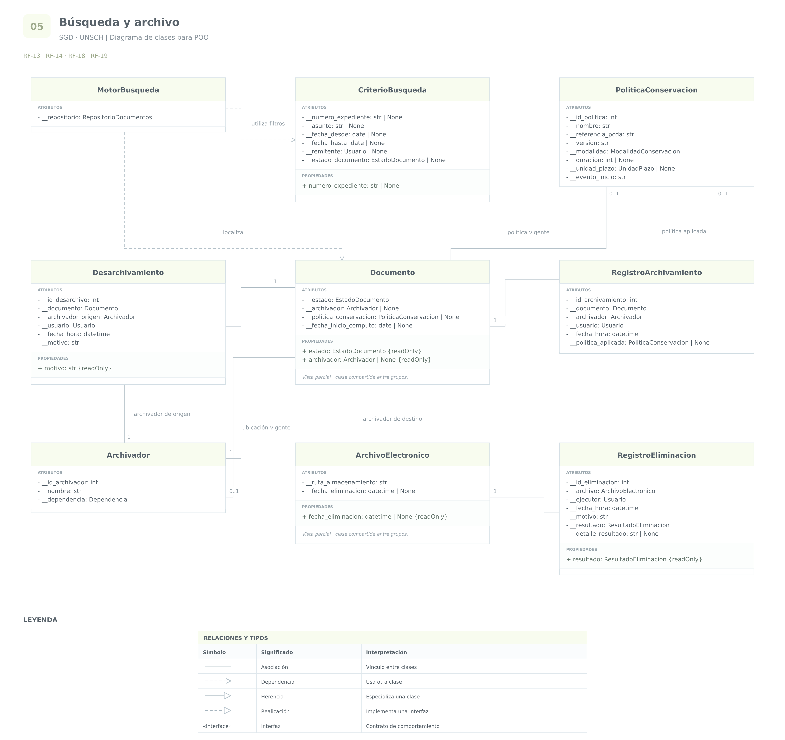

# Grupo 5 · Búsqueda y archivo

**Sistema de Gestión Documental a integrar en el SIIGE**  
**Universidad Nacional de San Cristóbal de Huamanga — UNSCH**

Análisis de las funcionalidades **13, 14, 18 y 19**.

Este grupo distingue la búsqueda de información, el desarchivo,
la organización documental, la conservación y la eliminación.

Las clases existentes se reutilizan. Las estructuras y restricciones
no establecidas expresamente en los requerimientos se presentan
como propuestas de diseño.

## RF-13 · Búsqueda de documentos

### 1. Requerimiento original

> El Sistema de Gestión Documental (SGD) debe contar con un motor de búsqueda eficiente que permita la recuperación (desarchivar documentos), mediante criterios de búsqueda como número de expediente, asunto, fecha, remitente, entre otros.

### 2. Análisis

El sistema debe localizar documentos mediante diferentes criterios.

Se proponen:

- **CriterioBusqueda:** representa los filtros de una consulta.
- **MotorBusqueda:** coordina la búsqueda de documentos.

Se reutilizan **Documento**, **Tramite** y **Usuario**.

Los filtros no deben convertirse en copias permanentes
de los datos del documento. Representan las condiciones
que el usuario introduce para realizar una consulta.

Se distingue entre:

- Buscar: localizar y consultar información.
- Desarchivar: cambiar la situación archivística de un documento.

Una búsqueda no debe desarchivar automáticamente los resultados.
El desarchivo se analiza en la funcionalidad 14.

El número de expediente, asunto y remitente se consultan mediante
la relación entre Documento y Tramite, según el modelo del grupo 1.

El criterio “fecha” requiere precisar si corresponde al registro,
la recepción u otro evento. No se presupone que todas esas fechas
sean equivalentes.

La eficiencia no se representa mediante un atributo llamado
`eficiente`. Deben definirse condiciones medibles de respuesta
según el volumen de documentos y los usuarios concurrentes.

**Consideraciones de base de datos:**

- Los filtros se aplican sobre los datos existentes y sus relaciones.
- CriterioBusqueda no necesita una tabla propia si solamente
  representa una consulta temporal.
- MotorBusqueda es un servicio; no necesita una tabla con su nombre.
- Los índices deben seleccionarse según las consultas reales.
- Para fechas y nombres deben definirse las reglas de comparación.
- La consulta debe aplicar los permisos del usuario.
- Se propone paginar los resultados para evitar cargar
  todos los documentos simultáneamente.

### 3. Cuadro de clases y atributos

| Clase | Atributo o propiedad | Tipo de dato | Visibilidad | Justificación |
|---|---|---|---|---|
| `CriterioBusqueda` | `__numero_expediente` | `str` o `None` | Privado | Permite validar el código utilizado como filtro. |
| `CriterioBusqueda` | `__asunto` | `str` o `None` | Privado | Conserva el texto que se utilizará en la búsqueda. |
| `CriterioBusqueda` | `__fecha_desde` | `date` o `None` | Privado | Define el inicio del intervalo de búsqueda. |
| `CriterioBusqueda` | `__fecha_hasta` | `date` o `None` | Privado | Define el final del intervalo y permite validar su coherencia. |
| `CriterioBusqueda` | `__remitente` | `Usuario` o `None` | Privado | Filtra por un remitente identificado sin depender únicamente de su nombre. |
| `MotorBusqueda` | `__repositorio` | `RepositorioDocumentos` | Privado | Dependencia técnica para consultar documentos y sus relaciones. |
| `CriterioBusqueda` | `numero_expediente` | `str` o `None` | Propiedad pública de lectura y escritura validada | Permite consultar el filtro establecido. |

El intervalo y la búsqueda por un usuario identificado
son propuestas de diseño.

Los filtros pueden modificarse mediante operaciones validadas.
Por ejemplo, la fecha inicial no debe ser posterior a la final.

RepositorioDocumentos representa un contrato de acceso
a los datos, no una entidad documental adicional.

## RF-14 · Documentos activos, archivados y motivo del desarchivo

### 1. Requerimiento original

> El Sistema de Gestión Documental (SGD) debe permitir la búsqueda y recuperación (desarchivar documentos) tanto de documentos activos como archivados, se debe permitir guardar un asunto motivo del proceso.

### 2. Análisis

La búsqueda debe incluir documentos activos y archivados,
respetando los permisos del usuario.

Se reutilizan **Documento**, **CriterioBusqueda** y **MotorBusqueda**.

Se propone **EstadoDocumento** para representar inicialmente:

- `ACTIVO`
- `ARCHIVADO`

Estos estados corresponden al documento y se diferencian
del estado del trámite y de sus derivaciones.

Se incorpora **Desarchivamiento** para conservar el motivo
y los datos de cada operación de desarchivo.

La expresión “asunto motivo del proceso” se interpreta
como una explicación de la recuperación o desarchivo.
Debe confirmarse si la institución exige además un asunto
independiente del motivo.

Un documento activo puede localizarse y consultarse,
pero no necesita ser desarchivado.

Como propuesta, el desarchivo:

1. Comprueba que el documento esté archivado.
2. Comprueba la autorización del usuario.
3. Exige un motivo.
4. Registra la operación.
5. Cambia el documento a estado ACTIVO.

Si la institución utiliza otro significado de desarchivo,
por ejemplo un préstamo temporal, el flujo debe ajustarse
a esa definición.

**Consideraciones de base de datos:**

- Cada operación de desarchivo tiene identificación propia.
- Se conserva el documento, el archivador de origen,
  el usuario, la fecha y el motivo.
- Un nuevo desarchivo no debe sobrescribir operaciones anteriores.
- El motivo no debe confundirse con el asunto del trámite.
- El cambio de estado y el registro del desarchivo deben
  confirmarse de forma consistente.
- Desarchivar no debe reiniciar automáticamente el plazo
  de conservación del documento.

### 3. Cuadro de clases y atributos

| Clase | Atributo o propiedad | Tipo de dato | Visibilidad | Justificación |
|---|---|---|---|---|
| `Documento` | `__estado` | `EstadoDocumento` | Privado | Controla los cambios entre activo y archivado mediante operaciones válidas. |
| `Documento` | `estado` | `EstadoDocumento` | Propiedad pública de solo lectura | Permite consultar la situación documental sin modificarla directamente. |
| `CriterioBusqueda` | `__estado_documento` | `EstadoDocumento` o `None` | Privado | Permite filtrar por estado o buscar sin esa restricción. |
| `Desarchivamiento` | `__id_desarchivo` | `int` | Privado | Identificador técnico propuesto para cada operación. |
| `Desarchivamiento` | `__documento` | `Documento` | Privado | Identifica el documento recuperado. |
| `Desarchivamiento` | `__archivador_origen` | `Archivador` | Privado | Conserva desde qué archivador se recuperó. |
| `Desarchivamiento` | `__usuario` | `Usuario` | Privado | Conserva quién realizó la operación. |
| `Desarchivamiento` | `__fecha_hora` | `datetime` | Privado | Conserva cuándo ocurrió. |
| `Desarchivamiento` | `__motivo` | `str` | Privado | Conserva la explicación obligatoria de la operación. |
| `Desarchivamiento` | `motivo` | `str` | Propiedad pública de solo lectura | Permite consultar la explicación sin modificar el historial. |

Los datos de un desarchivo confirmado se proponen de solo lectura.
Una rectificación debe conservar la trazabilidad correspondiente.

## RF-18 · Archivadores y políticas de conservación

### 1. Requerimiento original

> El Sistema de Gestión Documental (SGD) debe contar con una gestión de archivadores, que permita almacenar los documentos de manera organizada, con opciones para archivar documentos de acuerdo con las políticas de conservación de acuerdo con el “Programa de Control de Documentos Archivísticos” P.C.D.A. UNSCH.

### 2. Análisis

Se identifican:

- **Archivador:** representa una agrupación organizada de documentos.
- **PoliticaConservacion:** representa una regla institucional
  de conservación.
- **RegistroArchivamiento:** conserva cada operación de archivamiento.

Se reutilizan **Documento**, **Usuario** y **Dependencia**.

Archivador representa una organización documental.
No se considera automáticamente equivalente a una carpeta física
del servidor donde se almacenan archivos.

La política se propone asociada al documento correspondiente.
No se presupone que todos los documentos de un archivador
tengan el mismo plazo de conservación.

Para conservar el historial, cada registro de archivamiento
identifica al documento, al archivador, al responsable
y a la política aplicada cuando corresponda.

El requerimiento menciona el P.C.D.A. UNSCH, pero no incorpora
su contenido. Por ello, no se asignan plazos concretos ni se establece
arbitrariamente desde qué fecha deben contarse.

La fecha de archivamiento y la fecha de inicio del cómputo
de conservación pueden ser diferentes.

Se propone distinguir políticas temporales y permanentes,
cuando esa distinción corresponda al instrumento institucional.

**Consideraciones de base de datos:**

- Archivador y PoliticaConservacion tienen identificadores propios.
- Los documentos referencian su ubicación archivística vigente.
- RegistroArchivamiento conserva el historial de operaciones.
- La política debe identificar su referencia y versión institucional.
- Una modificación de política no debe cambiar silenciosamente
  las reglas históricas aplicadas a documentos existentes.
- Las reglas deben permitir identificar la duración,
  la unidad y el evento desde el que se calcula el plazo.
- La ausencia de una política definida no equivale
  a autorización para eliminar.
- Debe impedirse eliminar un archivador de forma que se pierdan
  sus documentos o su historial.

### 3. Cuadro de clases y atributos

| Clase | Atributo o propiedad | Tipo de dato | Visibilidad | Justificación |
|---|---|---|---|---|
| `Archivador` | `__id_archivador` | `int` | Privado | Identificador técnico propuesto. |
| `Archivador` | `__nombre` | `str` | Privado | Permite administrar su denominación mediante validación. |
| `Archivador` | `__dependencia` | `Dependencia` | Privado | Identifica la dependencia responsable de la agrupación documental. |
| `Documento` | `__archivador` | `Archivador` o `None` | Privado | Mantiene controlada su ubicación archivística vigente. |
| `Documento` | `__politica_conservacion` | `PoliticaConservacion` o `None` | Privado | Referencia la regla y versión aplicables al documento. |
| `Documento` | `__fecha_inicio_computo` | `date` o `None` | Privado | Conserva la fecha validada desde la que corresponde calcular la conservación. |
| `PoliticaConservacion` | `__id_politica` | `int` | Privado | Identificador técnico propuesto para una política o versión. |
| `PoliticaConservacion` | `__nombre` | `str` | Privado | Identifica la regla de conservación. |
| `PoliticaConservacion` | `__referencia_pcda` | `str` | Privado | Identifica la disposición institucional que respalda la regla. |
| `PoliticaConservacion` | `__version` | `str` | Privado | Distingue la versión aplicable y permite conservar su trazabilidad. |
| `PoliticaConservacion` | `__modalidad` | `ModalidadConservacion` | Privado | Distingue conservación temporal o permanente cuando corresponda. |
| `PoliticaConservacion` | `__duracion` | `int` o `None` | Privado | Representa la duración establecida para una política temporal. |
| `PoliticaConservacion` | `__unidad_plazo` | `UnidadPlazo` o `None` | Privado | Define cómo interpretar la duración, según la política institucional. |
| `PoliticaConservacion` | `__evento_inicio` | `str` | Privado | Identifica el evento institucional que inicia el cómputo. |
| `RegistroArchivamiento` | `__id_archivamiento` | `int` | Privado | Identificador técnico propuesto para cada operación. |
| `RegistroArchivamiento` | `__documento` | `Documento` | Privado | Identifica el documento archivado. |
| `RegistroArchivamiento` | `__archivador` | `Archivador` | Privado | Conserva dónde se archivó. |
| `RegistroArchivamiento` | `__usuario` | `Usuario` | Privado | Conserva quién realizó la operación. |
| `RegistroArchivamiento` | `__fecha_hora` | `datetime` | Privado | Conserva cuándo se archivó. |
| `RegistroArchivamiento` | `__politica_aplicada` | `PoliticaConservacion` o `None` | Privado | Conserva la referencia a la política aplicada en ese momento. |
| `Documento` | `archivador` | `Archivador` o `None` | Propiedad pública de solo lectura | Permite consultar su ubicación sin cambiarla directamente. |

Las modalidades, unidades y reglas concretas deben establecerse
a partir del P.C.D.A. aplicable.

La descripción textual del evento de inicio documenta la regla,
pero no basta por sí sola para calcular automáticamente
el vencimiento. Esa regla deberá implementarse y validarse.

Las políticas utilizadas deben conservar versiones históricas.
Los cambios de ubicación o política deben realizarse mediante
operaciones autorizadas y auditadas.

## RF-19 · Eliminación y ubicación de los archivos

### 1. Requerimiento original

> El Sistema de Gestión Documental (SGD) debe permitir la eliminación segura de documentos una vez cumplido su ciclo de vida o el plazo legal de conservación.

**Aclaración del documento:**

> (Se aclara que el requerimiento estipula que el proveedor debe indicar la ruta donde se almacenarán los archivos del sistema para permitir a la oficina de tecnología pueda realizar la eliminación de archivos en el servidor o poder realizar copias de seguridad, según corresponda.)

### 2. Análisis

El texto principal establece una eliminación condicionada
al ciclo de vida o al plazo de conservación.

La aclaración exige informar la ruta de almacenamiento
para que la oficina de tecnología pueda realizar operaciones
de eliminación o respaldo.

Debe diferenciarse entre:

- Eliminar un registro de la base de datos.
- Eliminar el archivo almacenado.
- Cambiar el estado del documento.
- Gestionar las copias de seguridad.

Estas acciones no son equivalentes.

Se reutilizan **Documento**, **ArchivoElectronico**,
**PoliticaConservacion** y **Usuario**.

Se propone **RegistroEliminacion** para conservar el resultado
de cada operación realizada sobre un archivo.

La ruta de almacenamiento se incorpora a ArchivoElectronico,
porque identifica el archivo utilizado por el sistema.

Conocer la ruta no garantiza por sí solo una eliminación segura.
Deben definirse el procedimiento, la autorización y la verificación
correspondientes.

El vencimiento de un plazo permite identificar un documento
para evaluación; no se interpreta automáticamente como autorización
de eliminación.

La aclaración tampoco establece que el proveedor deba implementar
un borrado automático completo. Debe precisarse qué operaciones
realizará la aplicación y cuáles ejecutará la oficina de tecnología.

**Consideraciones de base de datos:**

- La ruta debe relacionarse con el archivo correspondiente.
- El historial de eliminación debe conservarse aunque el archivo
  ya no exista.
- No debe eliminarse en cascada la auditoría al borrar documentos.
- Un fallo de eliminación debe registrarse como fallo.
- La fecha de eliminación del archivo se completa solamente
  cuando la operación se haya confirmado.
- Si un documento tiene varios archivos, no debe marcarse
  como eliminado completamente cuando solo se eliminó uno.
- La política de respaldos debe definir el tratamiento de las copias.
- Deben conservarse los metadatos e historiales que correspondan
  según las reglas institucionales aplicables.

Como propuesta, EstadoDocumento puede ampliarse con:

- `ELIMINACION_PENDIENTE`
- `ELIMINADO`

Estos estados requieren reglas de transición y verificación;
no sustituyen la operación efectiva sobre los archivos.

### 3. Cuadro de clases y atributos

| Clase | Atributo o propiedad | Tipo de dato | Visibilidad | Justificación |
|---|---|---|---|---|
| `ArchivoElectronico` | `__ruta_almacenamiento` | `str` | Privado | Identifica la ubicación del archivo y evita su modificación directa sin coordinación con el almacenamiento. |
| `ArchivoElectronico` | `__fecha_eliminacion` | `datetime` o `None` | Privado | Conserva cuándo se confirmó la eliminación del archivo. |
| `Documento` | `__estado` | `EstadoDocumento` | Privado | Cambia después de validar las condiciones y el resultado de la operación. |
| `RegistroEliminacion` | `__id_eliminacion` | `int` | Privado | Identificador técnico propuesto para cada operación. |
| `RegistroEliminacion` | `__archivo` | `ArchivoElectronico` | Privado | Identifica el archivo sobre el que se realizó la operación. |
| `RegistroEliminacion` | `__ejecutor` | `Usuario` | Privado | Conserva al responsable de la operación registrada. |
| `RegistroEliminacion` | `__fecha_hora` | `datetime` | Privado | Conserva cuándo se ejecutó. |
| `RegistroEliminacion` | `__motivo` | `str` | Privado | Conserva la justificación de la operación. |
| `RegistroEliminacion` | `__resultado` | `ResultadoEliminacion` | Privado | Distingue una eliminación confirmada de una operación fallida. |
| `RegistroEliminacion` | `__detalle_resultado` | `str` o `None` | Privado | Conserva información necesaria para verificar el resultado. |
| `RegistroEliminacion` | `resultado` | `ResultadoEliminacion` | Propiedad pública de solo lectura | Permite consultar lo ocurrido sin modificar el historial. |
| `ArchivoElectronico` | `fecha_eliminacion` | `datetime` o `None` | Propiedad pública de solo lectura | Permite consultar cuándo se confirmó la eliminación. |

El acceso a la ruta se proporciona mediante operaciones autorizadas
de administración del almacenamiento. No se propone su exposición
general a todos los usuarios.

Los datos de una eliminación confirmada se proponen de solo lectura.

No se identifican atributos que requieran acceso protegido
desde subclases. La modificación de datos se realiza mediante
operaciones públicas controladas, sin exponer los atributos internos.

## Diagrama y código del grupo

[Volver al índice](../README.md) · [Ver código](../codigo/busqueda_y_archivo.py) · [Abrir draw.io editable](../diagramas/SGD_UNSCH_Diagramas_Clases.drawio)

