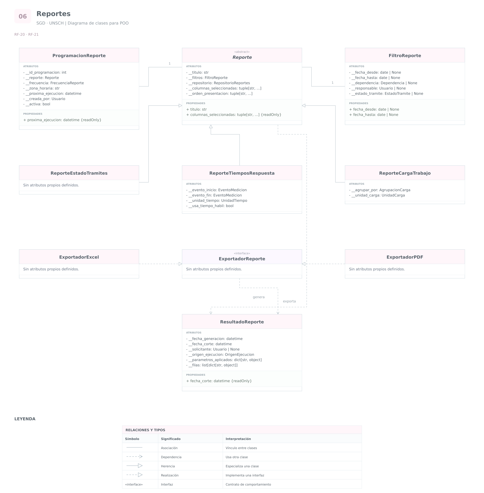

# Grupo 6 · Reportes

**Sistema de Gestión Documental a integrar en el SIIGE**  
**Universidad Nacional de San Cristóbal de Huamanga — UNSCH**

Análisis de las funcionalidades **20 y 21**.

Este grupo comprende la generación automática de reportes,
la personalización de su contenido y la exportación a formatos
como Excel y PDF.

Las clases existentes se reutilizan. Las métricas, estructuras
y restricciones no definidas expresamente en los requerimientos
se presentan como propuestas de diseño.

## RF-20 · Generación automática de reportes

### 1. Requerimiento original

> El Sistema de Gestión Documental (SGD) debe generar reportes automáticos sobre el estado de los trámites, tiempos de respuesta, carga de trabajo por usuario o área, y otros indicadores de desempeño.

### 2. Análisis

El sistema debe producir reportes a partir de la información
registrada durante la atención de los trámites.

Se identifican tres tipos expresamente mencionados:

- Reporte del estado de los trámites.
- Reporte de tiempos de respuesta.
- Reporte de carga de trabajo por usuario o área.

Se propone **Reporte** como una clase abstracta que concentra
los elementos comunes de configuración y generación.

Se proponen las siguientes especializaciones:

- **ReporteEstadoTramites:** calcula la distribución de trámites
  según su estado.
- **ReporteTiemposRespuesta:** calcula duraciones entre eventos
  definidos del proceso.
- **ReporteCargaTrabajo:** calcula la carga según una unidad
  de trabajo y un criterio de agrupación.

La especialización se justifica por las diferencias de cálculo.
No es necesario duplicar en cada subclase los filtros
y las operaciones comunes.

También se proponen:

- **ResultadoReporte:** representa la información obtenida
  en una ejecución.
- **ProgramacionReporte:** define cuándo debe ejecutarse
  automáticamente un reporte.
- **FiltroReporte:** representa las condiciones de selección,
  desarrolladas en RF-21.

La definición del reporte, su programación y su resultado
son elementos diferentes.

Un mismo reporte puede ejecutarse varias veces y producir
resultados distintos porque cambian los datos o el momento
de consulta.

#### Reporte de estados

Debe definirse si se desea conocer:

- El estado actual de los trámites al generar el reporte.
- El estado que tenían en una fecha histórica.

Consultar solamente el estado actual no permite reconstruir
correctamente una fecha anterior.

Para una consulta histórica deben utilizarse los cambios
registrados en CambioEstadoTramite, analizado en el grupo 3.

#### Reporte de tiempos de respuesta

El documento no define desde qué evento hasta cuál debe medirse.

Como ejemplos de medición pueden considerarse:

- Registro del trámite hasta su finalización.
- Derivación hasta su aceptación.
- Solicitud de visto bueno hasta su resolución.

Estos ejemplos no son métricas obligatorias del requerimiento.
Cada indicador debe definir:

- Evento inicial.
- Evento final.
- Unidad de medida.
- Uso de tiempo calendario o tiempo hábil.
- Tratamiento de los casos pendientes.
- Tratamiento de datos faltantes o inconsistentes.

Un trámite pendiente no tiene un tiempo de respuesta final.
Su antigüedad puede mostrarse como otro indicador,
pero no debe sustituirse por cero.

#### Reporte de carga de trabajo

Debe precisarse qué se contará:

- Documentos con asignaciones vigentes.
- Trámites pendientes de atención.
- Derivaciones pendientes de aceptación.
- Otra unidad establecida por la institución.

Cantidad de documentos y cantidad de trámites no son equivalentes.

El modelo debe identificar la unidad utilizada y evitar
contar varias veces el mismo elemento por combinar
tablas con relaciones de uno a muchos.

La carga histórica debe obtenerse de las asignaciones
y responsabilidades vigentes en la fecha consultada,
no solamente de la situación actual del usuario.

#### Generación automática

Se propone ProgramacionReporte para establecer una frecuencia,
la zona horaria y el siguiente momento de ejecución.

El requerimiento no establece una frecuencia concreta.
No se presupone que todos los reportes deban ejecutarse diariamente.

La ejecución automática tampoco implica el envío por correo.
Si se requiere distribuir los reportes, debe definirse
esa operación y relacionarla con el grupo de notificaciones.

**Consideraciones de base de datos:**

- Los reportes consultan los datos de trámites, estados,
  derivaciones, solicitudes y asignaciones.
- No se necesita una tabla independiente por cada tipo de reporte.
- Una programación persistente sí requiere conservar su definición
  y los datos necesarios para ejecutarla.
- Guardar todos los resultados completos es una decisión
  de conservación, no una exigencia expresa del requerimiento.
- Si se conserva un resultado, debe acompañarse de los filtros,
  la fecha de corte y la definición del indicador utilizado.
- Una ejecución debe utilizar una visión consistente de los datos
  para evitar mezclar situaciones incompatibles.
- Las consultas deben respetar los permisos sobre las dependencias
  y los datos incluidos.
- Los índices se seleccionarán según las consultas reales.
- Las ejecuciones automáticas deben identificar al proceso
  responsable para su auditoría.

### 3. Cuadro de clases y atributos

| Clase | Atributo o propiedad | Tipo de dato | Visibilidad | Justificación |
|---|---|---|---|---|
| `Reporte` | `__titulo` | `str` | Privado | Identifica el reporte y permite controlar su denominación. |
| `Reporte` | `__filtros` | `FiltroReporte` | Privado | Conserva las condiciones de selección utilizadas. |
| `Reporte` | `__repositorio` | `RepositorioReportes` | Privado | Dependencia técnica para consultar los datos necesarios. |
| `Reporte` | `titulo` | `str` | Propiedad pública de lectura y escritura validada | Permite identificar el reporte sin modificar directamente su atributo interno. |
| `ReporteTiemposRespuesta` | `__evento_inicio` | `EventoMedicion` | Privado | Define desde qué evento se calculará la duración. |
| `ReporteTiemposRespuesta` | `__evento_fin` | `EventoMedicion` | Privado | Define el evento que completa la medición. |
| `ReporteTiemposRespuesta` | `__unidad_tiempo` | `UnidadTiempo` | Privado | Permite interpretar correctamente las duraciones calculadas. |
| `ReporteTiemposRespuesta` | `__usa_tiempo_habil` | `bool` | Privado | Distingue la medición según calendario continuo o calendario hábil. |
| `ReporteCargaTrabajo` | `__agrupar_por` | `AgrupacionCarga` | Privado | Define si la carga se presenta por usuario o dependencia. |
| `ReporteCargaTrabajo` | `__unidad_carga` | `UnidadCarga` | Privado | Identifica qué elemento se cuenta para medir la carga. |
| `ResultadoReporte` | `__fecha_generacion` | `datetime` | Privado | Conserva cuándo se produjo el resultado. |
| `ResultadoReporte` | `__fecha_corte` | `datetime` | Privado | Identifica hasta qué momento se consideran los datos. |
| `ResultadoReporte` | `__solicitante` | `Usuario` o `None` | Privado | Identifica al usuario que solicitó una ejecución manual. |
| `ResultadoReporte` | `__origen_ejecucion` | `OrigenEjecucion` | Privado | Distingue una ejecución manual de una programada. |
| `ResultadoReporte` | `__parametros_aplicados` | `dict[str, object]` | Privado | Conserva una copia de las condiciones y definiciones efectivamente utilizadas. |
| `ResultadoReporte` | `__filas` | `list[dict[str, object]]` | Privado | Conserva los resultados sin exponer directamente su modificación. |
| `ResultadoReporte` | `fecha_corte` | `datetime` | Propiedad pública de solo lectura | Permite interpretar a qué momento corresponde el resultado. |
| `ProgramacionReporte` | `__id_programacion` | `int` | Privado | Identificador técnico propuesto para cada programación. |
| `ProgramacionReporte` | `__reporte` | `Reporte` | Privado | Identifica qué definición de reporte se ejecutará. |
| `ProgramacionReporte` | `__frecuencia` | `FrecuenciaReporte` | Privado | Define la periodicidad admitida por la configuración. |
| `ProgramacionReporte` | `__zona_horaria` | `str` | Privado | Permite interpretar correctamente los horarios de ejecución. |
| `ProgramacionReporte` | `__proxima_ejecucion` | `datetime` | Privado | Conserva el siguiente momento programado. |
| `ProgramacionReporte` | `__creada_por` | `Usuario` | Privado | Identifica al responsable de configurar la programación. |
| `ProgramacionReporte` | `__activa` | `bool` | Privado | Permite habilitar o suspender la programación mediante una operación autorizada. |
| `ProgramacionReporte` | `proxima_ejecucion` | `datetime` | Propiedad pública de solo lectura | Permite consultar cuándo corresponde ejecutar el reporte. |

ReporteEstadoTramites no necesita atributos propios inicialmente:
reutiliza los filtros y se diferencia por su cálculo.

RepositorioReportes representa un contrato de consulta;
no implica una tabla adicional con ese nombre.

Si se utiliza tiempo hábil, debe proporcionarse el calendario
institucional aplicable. El indicador no puede calcularse
correctamente únicamente con el valor de un atributo booleano.

Las colecciones de resultados y parámetros deben conservarse
sin cambios después de confirmar la generación.
Su consulta debe evitar exponer referencias internas modificables.

## RF-21 · Personalización y exportación de reportes

### 1. Requerimiento original

> El Sistema de Gestión Documental (SGD) debe permitir la personalización de los reportes y exportarlos en formatos estándar como Excel o PDF.

### 2. Análisis

El sistema debe permitir adaptar el contenido de los reportes
y obtener archivos en los formatos admitidos.

Se reutilizan **Reporte** y **ResultadoReporte**.

Se desarrolla **FiltroReporte** y se propone
**ExportadorReporte** como contrato de exportación.

Como implementaciones iniciales se consideran:

- **ExportadorExcel:** genera la representación en Excel.
- **ExportadorPDF:** genera la representación en PDF.

Se propone **FormatoExportacion** con los valores
`EXCEL` y `PDF`.

La personalización no debe confundirse con cambiar
arbitrariamente la fórmula de un indicador.

Como propuesta inicial, se permite seleccionar:

- Intervalo de fechas.
- Dependencia.
- Usuario responsable.
- Estado del trámite.
- Columnas admitidas.
- Orden de presentación.

El requerimiento no enumera estas opciones;
se proponen para concretar la personalización.

Los filtros aplicables dependen del tipo de reporte.
Por ejemplo, un reporte de tiempos necesita precisar
a qué evento corresponde el intervalo de fechas.

Los criterios de agrupación también deben ser compatibles
con la métrica. No todas las columnas pueden agruparse
o sumarse de la misma manera.

La exportación debe representar el resultado calculado
y sus parámetros. Excel y PDF deben conservar
el mismo significado de los indicadores.

No se considera necesario incluir en el objeto Reporte
una ruta pública del servidor para descargar el archivo.
La descarga debe gestionarse mediante una operación autorizada.

**Consideraciones de base de datos:**

- FiltroReporte puede ser un objeto temporal sin tabla propia.
- Si se guardan configuraciones personalizadas, deben persistirse
  sus valores y el usuario o ámbito al que pertenecen.
- Los identificadores de usuario y dependencia se relacionan
  con los registros existentes.
- Las columnas y criterios de orden deben seleccionarse
  de una lista admitida por cada reporte.
- La personalización no debe permitir introducir instrucciones
  de consulta arbitrarias.
- Exportar datos requiere la misma autorización que consultarlos.
- Si se conserva el archivo generado, debe definirse su acceso,
  ubicación y período de conservación.
- No debe limitarse silenciosamente el contenido exportado
  a la página visible de resultados.
- Debe indicarse si la exportación contiene todos los resultados
  filtrados o solamente una selección solicitada.
- La operación de exportación debe poder registrarse en auditoría.

### 3. Cuadro de clases y atributos

| Clase | Atributo o propiedad | Tipo de dato | Visibilidad | Justificación |
|---|---|---|---|---|
| `FiltroReporte` | `__fecha_desde` | `date` o `None` | Privado | Define el inicio del intervalo y permite validar su coherencia. |
| `FiltroReporte` | `__fecha_hasta` | `date` o `None` | Privado | Define el final del intervalo sin permitir un rango inválido. |
| `FiltroReporte` | `__dependencia` | `Dependencia` o `None` | Privado | Limita los datos a una dependencia dentro del alcance autorizado. |
| `FiltroReporte` | `__responsable` | `Usuario` o `None` | Privado | Permite seleccionar al usuario responsable cuando la métrica lo admite. |
| `FiltroReporte` | `__estado_tramite` | `EstadoTramite` o `None` | Privado | Permite seleccionar un estado válido cuando corresponde al reporte. |
| `FiltroReporte` | `fecha_desde` | `date` o `None` | Propiedad pública de lectura y escritura validada | Permite consultar el intervalo configurado. |
| `FiltroReporte` | `fecha_hasta` | `date` o `None` | Propiedad pública de lectura y escritura validada | Permite consultar el intervalo configurado. |
| `Reporte` | `__columnas_seleccionadas` | `tuple[str, ...]` | Privado | Conserva únicamente columnas admitidas por la definición del reporte. |
| `Reporte` | `__orden_presentacion` | `tuple[str, ...]` | Privado | Controla los criterios de orden que pueden aplicarse. |
| `Reporte` | `columnas_seleccionadas` | `tuple[str, ...]` | Propiedad pública de solo lectura | Permite consultar qué columnas se incluirán. |
| `ResultadoReporte` | `__exportadores` | No se propone como atributo | No aplica | El resultado no necesita administrar las implementaciones que lo exportan. |

ExportadorReporte define una operación pública para exportar
un ResultadoReporte al formato correspondiente.

ExportadorExcel y ExportadorPDF pueden implementar esa operación
sin atributos propios inicialmente. No es necesario inventar
atributos para que cada clase tenga datos.

La selección del exportador se realiza en la operación
que coordina la exportación, utilizando FormatoExportacion.

Los filtros y columnas pueden modificarse durante la preparación
del reporte mediante operaciones validadas. El resultado ya generado
conserva una copia de los parámetros efectivamente aplicados.

No se proponen atributos protegidos porque las subclases
pueden utilizar operaciones y propiedades de la clase base.
La herencia no exige acceso directo a sus atributos internos.

## Diagrama y código del grupo

[Volver al índice](../README.md) · [Ver código](../codigo/reportes.py) · [Abrir draw.io editable](../diagramas/SGD_UNSCH_Diagramas_Clases.drawio)

