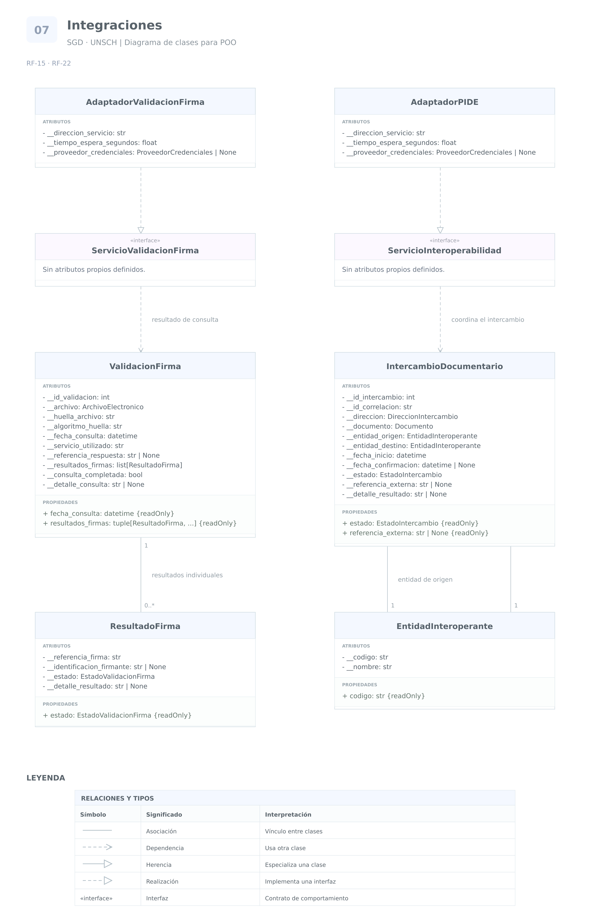

# Grupo 7 · Integraciones

**Sistema de Gestión Documental a integrar en el SIIGE**  
**Universidad Nacional de San Cristóbal de Huamanga — UNSCH**

Análisis de las funcionalidades **15 y 22**.

Este grupo representa la comunicación del SGD con servicios externos.

Se diferencia entre:

- Las clases que representan información del sistema.
- Los contratos que definen las operaciones externas.
- Los adaptadores que implementan la comunicación.
- Los registros que conservan los resultados de cada operación.

Los contratos técnicos de los servicios no están incluidos
en el documento de requerimientos. Por ello, no se presuponen
direcciones, protocolos, credenciales ni estructuras de respuesta.

## RF-15 · Validación de documentos firmados digitalmente

### 1. Requerimiento original

> El Sistema de Gestión Documental (SGD) debe permitir la validación de documentos firmados digitalmente para garantizar su autenticidad e integridad.

**Aclaración del documento:**

> (La Universidad facilitará el servicio web de validación de firma digital para permitir la integración de este.)

### 2. Análisis

El sistema debe utilizar el servicio web proporcionado
por la universidad para validar documentos firmados digitalmente.

Se reutilizan **Documento** y **ArchivoElectronico**.

La validación debe relacionarse con el archivo concreto
que se examinó, porque un documento puede tener varios adjuntos
o cambiar de archivo durante su elaboración.

Se proponen los siguientes elementos:

- **ServicioValidacionFirma:** contrato de las operaciones
  que el SGD necesita del servicio externo.
- **AdaptadorValidacionFirma:** implementación que realiza
  la comunicación con el servicio institucional.
- **ValidacionFirma:** registro de una consulta de validación
  sobre un archivo concreto.
- **ResultadoFirma:** resultado correspondiente a cada firma
  identificada en el archivo.

ServicioValidacionFirma es una abstracción.
No representa una tabla ni una copia del servicio externo.

El adaptador transforma las solicitudes y respuestas
según el contrato que facilite la universidad.

#### Alcance de la validación

Validar una firma no significa crearla ni firmar el documento.
Este requerimiento no exige implementar la firma digital.

Tampoco basta comprobar que el documento contiene una imagen
de una firma o un texto que indique que está firmado.

El SGD debe interpretar el resultado proporcionado por el servicio
según su contrato y su alcance de validación.

No se presupone que el servicio compruebe todas las condiciones
posibles de una firma. Debe documentarse qué aspectos evalúa
y cómo comunica sus resultados.

#### Estados del resultado

Se propone **EstadoValidacionFirma** con los valores:

- `VALIDA`
- `INVALIDA`
- `INDETERMINADA`

INDETERMINADA representa que no se obtuvo una conclusión suficiente.
Por ejemplo, una indisponibilidad del servicio no demuestra
que la firma sea inválida.

La ausencia de firmas también debe distinguirse
de una firma encontrada que resulte inválida.

#### Archivos con varias firmas

No se propone almacenar únicamente un atributo booleano
`firma_valida` en Documento.

Un mismo archivo puede contener varias firmas con resultados
diferentes. La validación debe conservar esos resultados
sin reducirlos a un valor que oculte las diferencias.

El criterio para aceptar el documento completo debe definirse
según el proceso institucional y el servicio disponible.

#### Identificación del archivo examinado

Se propone conservar una huella del archivo validado
y el algoritmo utilizado para obtenerla.

La huella vincula el resultado con el contenido examinado.
No sustituye la validación de la firma.

Si cambia el archivo, el resultado anterior permanece
como antecedente histórico y no debe aplicarse automáticamente
al nuevo contenido.

**Consideraciones de base de datos:**

- Cada ValidacionFirma tiene un identificador propio.
- Referencia al archivo examinado y conserva su huella.
- Cada ResultadoFirma se relaciona con una ValidacionFirma.
- Una nueva consulta no sobrescribe necesariamente la anterior.
- Se conserva la fecha de consulta y la identificación
  del servicio utilizado.
- Los códigos y detalles recibidos deben interpretarse
  según el contrato del servicio.
- Un fallo de comunicación debe distinguirse
  de una respuesta que declare una firma inválida.
- Los resultados y las operaciones deben poder relacionarse
  con la auditoría.
- Los parámetros de conexión y las credenciales no son datos
  que deban duplicarse en cada validación.

### 3. Cuadro de clases y atributos

| Clase | Atributo o propiedad | Tipo de dato | Visibilidad | Justificación |
|---|---|---|---|---|
| `ValidacionFirma` | `__id_validacion` | `int` | Privado | Identificador técnico propuesto para cada consulta registrada. |
| `ValidacionFirma` | `__archivo` | `ArchivoElectronico` | Privado | Identifica el archivo examinado. |
| `ValidacionFirma` | `__huella_archivo` | `str` | Privado | Vincula el resultado con el contenido concreto que se validó. |
| `ValidacionFirma` | `__algoritmo_huella` | `str` | Privado | Permite interpretar y comparar correctamente la huella conservada. |
| `ValidacionFirma` | `__fecha_consulta` | `datetime` | Privado | Conserva cuándo se solicitó la validación. |
| `ValidacionFirma` | `__servicio_utilizado` | `str` | Privado | Identifica el servicio que produjo la respuesta. |
| `ValidacionFirma` | `__referencia_respuesta` | `str` o `None` | Privado | Conserva el identificador externo cuando el servicio lo proporcione. |
| `ValidacionFirma` | `__resultados_firmas` | `list[ResultadoFirma]` | Privado | Conserva los resultados individuales sin permitir modificaciones directas de la colección. |
| `ValidacionFirma` | `__consulta_completada` | `bool` | Privado | Distingue una respuesta de validación procesada de una consulta que no pudo completarse. |
| `ValidacionFirma` | `__detalle_consulta` | `str` o `None` | Privado | Conserva información necesaria para explicar el procesamiento o su fallo. |
| `ResultadoFirma` | `__referencia_firma` | `str` | Privado | Identificador propuesto para distinguir la firma dentro de la respuesta. |
| `ResultadoFirma` | `__identificacion_firmante` | `str` o `None` | Privado | Conserva la identificación proporcionada por el servicio cuando exista. |
| `ResultadoFirma` | `__estado` | `EstadoValidacionFirma` | Privado | Conserva la conclusión sin permitir su alteración posterior. |
| `ResultadoFirma` | `__detalle_resultado` | `str` o `None` | Privado | Permite explicar la conclusión según los datos del servicio. |
| `ResultadoFirma` | `estado` | `EstadoValidacionFirma` | Propiedad pública de solo lectura | Permite consultar la conclusión sin modificarla. |
| `ValidacionFirma` | `fecha_consulta` | `datetime` | Propiedad pública de solo lectura | Permite conocer cuándo se realizó la consulta. |
| `ValidacionFirma` | `resultados_firmas` | `tuple[ResultadoFirma, ...]` | Propiedad pública de solo lectura | Permite consultar los resultados sin modificar directamente la colección interna. |
| `AdaptadorValidacionFirma` | `__direccion_servicio` | `str` | Privado | Conserva la configuración de conexión y evita su modificación arbitraria. |
| `AdaptadorValidacionFirma` | `__tiempo_espera_segundos` | `float` | Privado | Permite controlar el tiempo máximo de espera configurado. |
| `AdaptadorValidacionFirma` | `__proveedor_credenciales` | `ProveedorCredenciales` o `None` | Privado | Dependencia técnica para obtener la autenticación cuando el servicio la requiera. |

Los registros de validación confirmados se proponen de solo lectura.

ProveedorCredenciales representa una dependencia de configuración.
No implica que las credenciales deban almacenarse
en la tabla de validaciones.

ServicioValidacionFirma no necesita atributos propios.
Define las operaciones que implementará el adaptador
cuando se conozca el contrato institucional.

## RF-22 · Interoperabilidad con PIDE

### 1. Requerimiento original

> El Sistema de Gestión Documental (SGD) debe estar alineado a la plataforma de interoperabilidad del PIDE para permitir su integración documentaria.

### 2. Análisis

El sistema debe poder integrarse con la plataforma indicada
para la interoperabilidad documentaria.

El requerimiento no identifica los servicios concretos
que se utilizarán ni las operaciones, formatos o mecanismos
de autenticación correspondientes.

Por ello, no puede afirmarse únicamente con este texto
que el sistema deba implementar una operación específica
de envío o recepción.

Como propuesta de diseño se identifican:

- **ServicioInteroperabilidad:** contrato de las operaciones
  externas que necesitará el SGD.
- **AdaptadorPIDE:** implementación de la comunicación
  según los servicios y contratos aplicables.
- **IntercambioDocumentario:** registro de una operación
  de integración y su resultado.
- **EntidadInteroperante:** representa una institución
  participante cuando el intercambio requiera identificarla.

Se reutilizan **Documento**, **Tramite** y **ArchivoElectronico**
cuando la operación concreta necesite sus datos.

#### Institución y dependencia

EntidadInteroperante representa una institución participante.

Dependencia representa una unidad organizacional utilizada
en el flujo interno del SGD.

No se consideran automáticamente equivalentes:
una dependencia de la UNSCH no es lo mismo que otra institución.

Los códigos institucionales utilizados deben corresponder
a los identificadores establecidos por el servicio de integración.
No se inventan ni se confunden con los códigos locales.

#### Alcance del intercambio

Se propone **DireccionIntercambio** para distinguir
las operaciones de envío y recepción cuando ambas
formen parte del alcance confirmado.

Esta propuesta no significa que el requerimiento haya exigido
expresamente implementar las dos direcciones.

Se propone que cada IntercambioDocumentario identifique
un documento principal. El tratamiento de anexos o lotes
debe ajustarse al contrato del servicio correspondiente.

#### Estados de la operación

Se propone **EstadoIntercambio** con los valores:

- `PENDIENTE`
- `EN_PROCESO`
- `CONFIRMADO`
- `FALLIDO`
- `INDETERMINADO`

Estos valores pertenecen al intercambio externo.
No sustituyen al estado del trámite ni al de una derivación interna.

CONFIRMADO debe interpretarse según la confirmación real
que proporcione el servicio.

Una aceptación técnica del mensaje no se interpreta
automáticamente como aceptación administrativa del trámite.

INDETERMINADO permite representar una operación cuyo resultado
no se conoce con suficiente certeza, por ejemplo cuando
se interrumpe la comunicación antes de recibir la confirmación.

#### Identificadores locales y externos

Se propone conservar una identificación local de correlación
y la referencia externa cuando el servicio la proporcione.

El identificador externo no reemplaza automáticamente
el número de expediente de la UNSCH.

Si se reciben documentos externos, debe conservarse
la relación entre sus referencias de origen y los registros locales.

**Consideraciones de base de datos:**

- Cada IntercambioDocumentario tiene una clave primaria.
- Su identificador local de correlación se propone único.
- Las entidades participantes se relacionan mediante
  sus identificadores correspondientes.
- Se conservan la fecha de inicio, el resultado y la referencia
  devuelta por el servicio.
- Una respuesta externa debe vincularse con la operación correcta.
- Los reintentos deben conservar trazabilidad.
- Un identificador local no garantiza por sí solo
  que el servicio externo evite operaciones duplicadas.
- Ante un resultado indeterminado, debe comprobarse el mecanismo
  de consulta o conciliación disponible antes de repetir
  una operación que pueda generar duplicados.
- Los formatos y campos deben transformarse según el contrato
  confirmado, sin alterar el significado de los datos.
- Los archivos recibidos deben relacionarse con sus registros locales.
- Las operaciones de integración deben registrarse en auditoría.
- Los adaptadores y contratos no requieren tablas propias
  únicamente por existir como clases.

### 3. Cuadro de clases y atributos

| Clase | Atributo o propiedad | Tipo de dato | Visibilidad | Justificación |
|---|---|---|---|---|
| `EntidadInteroperante` | `__codigo` | `str` | Privado | Identifica a la institución mediante el código aplicable al intercambio. |
| `EntidadInteroperante` | `__nombre` | `str` | Privado | Conserva su denominación y permite controlar sus modificaciones. |
| `EntidadInteroperante` | `codigo` | `str` | Propiedad pública de solo lectura | Permite identificar a la institución sin modificar directamente su código. |
| `IntercambioDocumentario` | `__id_intercambio` | `int` | Privado | Identificador técnico propuesto para el registro local. |
| `IntercambioDocumentario` | `__id_correlacion` | `str` | Privado | Permite vincular solicitudes, respuestas y registros técnicos de una misma operación. |
| `IntercambioDocumentario` | `__direccion` | `DireccionIntercambio` | Privado | Distingue envío o recepción según el alcance confirmado. |
| `IntercambioDocumentario` | `__documento` | `Documento` | Privado | Identifica el documento local relacionado con la operación. |
| `IntercambioDocumentario` | `__entidad_origen` | `EntidadInteroperante` | Privado | Conserva la institución desde la que se origina el intercambio. |
| `IntercambioDocumentario` | `__entidad_destino` | `EntidadInteroperante` | Privado | Conserva la institución destinataria. |
| `IntercambioDocumentario` | `__fecha_inicio` | `datetime` | Privado | Conserva cuándo comenzó la operación. |
| `IntercambioDocumentario` | `__fecha_confirmacion` | `datetime` o `None` | Privado | Conserva cuándo se obtuvo una confirmación verificable. |
| `IntercambioDocumentario` | `__estado` | `EstadoIntercambio` | Privado | Cambia mediante operaciones que interpretan el resultado real del servicio. |
| `IntercambioDocumentario` | `__referencia_externa` | `str` o `None` | Privado | Conserva el identificador proporcionado por el sistema externo. |
| `IntercambioDocumentario` | `__detalle_resultado` | `str` o `None` | Privado | Permite explicar la confirmación, el fallo o la indeterminación. |
| `IntercambioDocumentario` | `estado` | `EstadoIntercambio` | Propiedad pública de solo lectura | Permite consultar el avance sin alterar directamente la operación. |
| `IntercambioDocumentario` | `referencia_externa` | `str` o `None` | Propiedad pública de solo lectura | Permite consultar la identificación externa obtenida. |
| `AdaptadorPIDE` | `__direccion_servicio` | `str` | Privado | Define el destino técnico de conexión según el servicio aplicable. |
| `AdaptadorPIDE` | `__tiempo_espera_segundos` | `float` | Privado | Controla el tiempo máximo de espera configurado. |
| `AdaptadorPIDE` | `__proveedor_credenciales` | `ProveedorCredenciales` o `None` | Privado | Obtiene la autenticación requerida sin incorporarla a los registros documentales. |

ServicioInteroperabilidad define las operaciones públicas
que necesite el SGD según el alcance confirmado.

AdaptadorPIDE implementa ese contrato. Si los servicios utilizados
tienen contratos diferentes, puede ser necesario separar
sus adaptadores.

No se propone una superclase común únicamente porque ambos
adaptadores utilicen una dirección y un tiempo de espera.
La herencia debe justificarse por comportamientos compartidos
y por la posibilidad de sustituir correctamente sus implementaciones.

No se identifican atributos que requieran acceso protegido.
Los parámetros internos permanecen privados y las integraciones
se utilizan mediante operaciones públicas definidas por sus contratos.

Las propiedades públicas de consulta no conceden autorización
a todos los usuarios: el acceso a resultados y operaciones
de integración debe respetar los permisos del sistema.

## Diagrama y código del grupo

[Volver al índice](../README.md) · [Ver código](../codigo/integraciones.py) · [Abrir draw.io editable](../diagramas/SGD_UNSCH_Diagramas_Clases.drawio)

